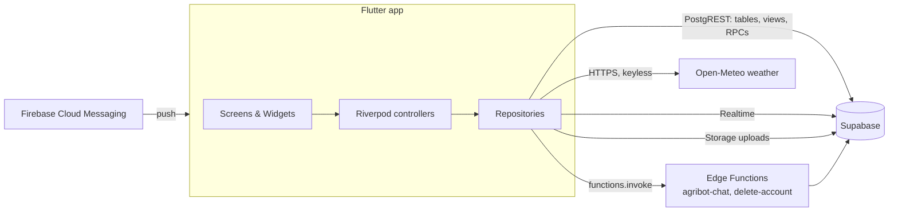
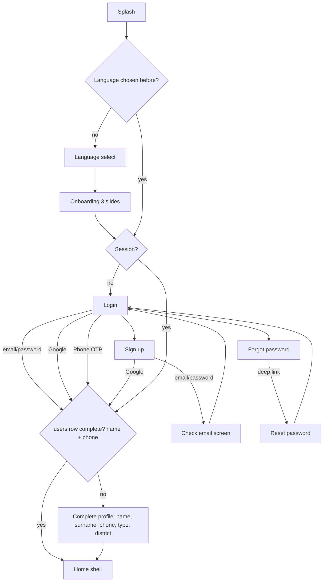

# FarmFriend Mobile App — Architecture & Build Specification

**Flutter + Dart · Supabase · Riverpod · English / සිංහල / தமிழ்**

| Item | Value |
|---|---|
| Product | FarmFriend — farmer mobile app for crop demand, price forecasting & surplus prevention, with AI assistant |
| This document | Single source of truth for building the **Flutter mobile app** |
| Shared backend | Supabase (Auth, Postgres, Storage, Realtime, Edge Functions) — same project as the web app |
| Reference UI | Web app `https://fyp-blue-beta.vercel.app` (farmer portal) |
| Forecast data | Produced by the team's ML model (Random Forest + price-elasticity quota solver) and stored in Supabase; the app reads it (§7, §13.6) |
| Chatbot | AgriBot via Supabase Edge Function `agribot-chat` (n8n + Gemini behind it) |
| Users | Farmers and buyers. Admins/officers use the web admin panel |
| Platforms | Android (primary, minSdk 23), iOS (secondary) |

---

## Table of Contents

0. [Security rules for the app](#0-security-rules-for-the-app)
1. [Scope & principles](#1-scope--principles)
2. [Tech stack & packages](#2-tech-stack--packages)
3. [Architecture](#3-architecture)
4. [Environment, secrets & configuration](#4-environment-secrets--configuration)
5. [Project file structure](#5-project-file-structure)
6. [Data model (Supabase → Dart)](#6-data-model)
7. [Backend contract (what the app expects)](#7-backend-contract)
8. [Authentication & onboarding](#8-authentication--onboarding)
9. [Navigation map & routes](#9-navigation-map--routes)
10. [Design system](#10-design-system)
11. [Screen specifications](#11-screen-specifications)
12. [Shared widget catalogue](#12-shared-widget-catalogue)
13. [Core business logic](#13-core-business-logic)
14. [Chatbot (AgriBot)](#14-chatbot-agribot)
15. [Weather](#15-weather-integration)
16. [Localization — English, Sinhala, Tamil](#16-localization)
17. [Realtime, notifications & offline cache](#17-realtime-notifications--offline-cache)
18. [Error handling, crash reporting & analytics](#18-error-handling-crash-reporting--analytics)
19. [Testing strategy](#19-testing-strategy)
20. [Build, signing & release](#20-build-signing--release)
21. [Implementation roadmap](#21-implementation-roadmap)
22. [Open questions](#22-open-questions)

---

## 0. Security rules for the app

> [!WARNING]
> The Google OAuth **client secret** from the web `.env.local` was shared outside the codebase — rotate it (Google Cloud Console → Credentials → web client → Reset secret) and update Supabase Auth → Google and Vercel. It is never used by the mobile app.

1. **Everything in the APK/IPA is public.** Only public-by-design values ship in the app:
   - ✅ Supabase URL and **publishable** key (`sb_publishable_…`) — access is enforced by RLS.
   - ✅ Google OAuth **client IDs** (web, Android, iOS).
   - ❌ Google client secret, Supabase service-role key, n8n webhook URL/key, Hugging Face/model API keys, FCM service-account keys — these live only in the backend (Edge Function secrets).
2. **The app never calls the ML model, n8n or any third-party API that needs a secret.** It talks only to Supabase (tables, RPCs, Edge Functions) and keyless public APIs (Open-Meteo weather).
3. **Session stored encrypted** (Android Keystore / iOS Keychain) via a `flutter_secure_storage` adapter — the `supabase_flutter` default is plain SharedPreferences (§8.7).
4. **RLS is the real security boundary;** client-side checks are UX only. Never send `u_role` from the app.
5. Never log tokens, passwords, phone numbers or emails. Never commit `env/*.json` (only `env/example.json`).

---

## 1. Scope & principles

### 1.1 Feature parity with the web farmer portal

| Web sidebar item | Mobile feature | Priority |
|---|---|---|
| Dashboard | Home dashboard (welcome hero, weather, stats, quick actions, my registrations, latest news) | P0 |
| Marketplace | Product catalogue (All / Seeds / Tools), search, product detail, add to cart | P0 |
| News | News list + detail | P0 |
| Community | Feed, create post (text + photo), like, comment, share, save, My Posts, Saved Posts | P0 |
| Cart | Cart, Cash-on-Delivery checkout, My Orders, order detail, cancel pending order | P0 |
| Registration | Register Harvest Quota ("Check & Register") with surplus warning + alternative crops, My Registered Quotas | P0 |
| Contact | Contact Support (complaints) + My Sent Messages with admin replies | P1 |
| Settings | Account, Notifications, Credentials (password), Language | P0 |
| Chat bubble | AgriBot chat (n8n/Gemini) | P0 |
| Bell icon | Notifications inbox | P1 |
| — (mobile extra) | National Bucket / Crop Outlook screen: live quota fill %, fair price, wholesale estimate per crop | P0 (core research objective) |
| — (mobile extra) | Crop Prices: model forecast vs past prices, best harvest month, planting window | P0 |
| — (mobile extra) | Profit Planner: land size → expected harvest, cost, income, profit from model numbers | P1 |
| — (mobile extra) | Phone OTP login, voice chat, push surplus alerts | P1 |

### 1.2 Out of scope (stay on web)
Admin dashboard, AI target generation, news/product/community moderation, complaint replies, user management. If a user with `u_role = 'admin'` logs in on mobile, show a farmer view plus a banner linking to the web admin panel.

### 1.3 Principles
- **Farmer-first UX:** big tap targets (≥48dp), icon + label everywhere, minimal typing, numeric keypads, Sinhala/Tamil from day one.
- **Same data, same rules as web:** mobile reads/writes the same tables; business rules that must be consistent (quota check, order placement) live in **Postgres RPCs**, not duplicated in two clients.
- **Works on poor connections:** cached reads, optimistic UI where safe, clear retry states.
- **Feature-first modules** so each team member can own a feature folder.

---

## 2. Tech stack & packages

| Concern | Choice | Why |
|---|---|---|
| Framework | Flutter 3.x stable, Dart 3.x | Thesis spec; single codebase |
| State management | `flutter_riverpod` + `riverpod_annotation` / `riverpod_generator` | Thesis test TC_MOB_01 uses Riverpod; testable, no BuildContext coupling |
| Routing | `go_router` | Declarative, redirect-based auth guards, deep links |
| Backend SDK | `supabase_flutter` | Auth, PostgREST, Storage, Realtime |
| Models | `freezed` + `json_serializable` | Immutable models, `copyWith`, unions |
| HTTP (non-Supabase) | `dio` | n8n webhook, weather; interceptors, timeouts |
| Google Sign-In | `google_sign_in` (native) → `supabase.auth.signInWithIdToken` | No client secret in app |
| Localization | `flutter_localizations` + `intl` + ARB files (`gen-l10n`) | Official, supports si/ta |
| Fonts | `google_fonts` or bundled **Noto Sans**, **Noto Sans Sinhala**, **Noto Sans Tamil** | Correct Sinhala/Tamil glyph shaping |
| Images | `cached_network_image`, `image_picker`, `flutter_image_compress` | Product/news/post images, uploads |
| Local cache | `hive_ce` + `hive_ce_flutter` (or `shared_preferences` for small prefs) | Offline lists, language, read-state |
| Connectivity | `connectivity_plus` | Offline banner |
| Chat UI | Custom widgets + `flutter_markdown` (render bot markdown) | Bot replies contain lists/bold |
| Charts | `fl_chart` | Quota fill, price trend |
| Sharing | `share_plus` | Community "Share" |
| Links | `url_launcher` | Open web admin, phone/email |
| Local notifications | `flutter_local_notifications` | Realtime-triggered alerts |
| Push (phase 2) | `firebase_messaging` | Server-sent push |
| Utilities | `uuid`, `intl` (dates/currency), `logger`, `equatable` (optional) | |
| Splash/icons | `flutter_native_splash`, `flutter_launcher_icons` | |
| Testing | `flutter_test`, `mocktail`, `integration_test`, `golden_toolkit` (optional) | |
| Lints | `very_good_analysis` or `flutter_lints` | |

### 2.1 `pubspec.yaml` (baseline)

> Add packages with `flutter pub add <name>` at project creation so you get the current compatible versions, then pin. Versions below are baselines; re-check major versions (notably `google_sign_in` 7.x API) before pinning.

```yaml
name: farmfriend
description: FarmFriend farmer mobile app
publish_to: "none"
version: 1.0.0+1

environment:
  sdk: ">=3.5.0 <4.0.0"

dependencies:
  flutter:
    sdk: flutter
  flutter_localizations:
    sdk: flutter
  intl: any

  supabase_flutter: ^2.8.0
  flutter_riverpod: ^2.6.0
  riverpod_annotation: ^2.6.0
  go_router: ^14.6.0
  freezed_annotation: ^2.4.0
  json_annotation: ^4.9.0
  dio: ^5.7.0
  google_sign_in: ^7.1.0

  hive_ce: ^2.8.0
  hive_ce_flutter: ^2.2.0
  shared_preferences: ^2.3.0
  connectivity_plus: ^6.1.0

  cached_network_image: ^3.4.0
  image_picker: ^1.1.0
  flutter_image_compress: ^2.3.0
  flutter_markdown: ^0.7.0
  fl_chart: ^0.69.0
  share_plus: ^10.1.0
  url_launcher: ^6.3.0
  flutter_local_notifications: ^18.0.0
  google_fonts: ^6.2.0
  uuid: ^4.5.0
  logger: ^2.5.0
  shimmer: ^3.0.0
  flutter_svg: ^2.0.0
  flutter_secure_storage: ^9.2.0      # §8.7
  package_info_plus: ^8.1.0           # §11.33 version gate
  sentry_flutter: ^8.10.0             # §18.3
  firebase_core: ^3.6.0               # §17.2
  firebase_messaging: ^15.1.0         # §17.2
  speech_to_text: ^7.0.0              # §14.4
  flutter_tts: ^4.2.0                 # §14.4
  sms_autofill: ^2.4.0                # §8.9 (Android OTP autofill)

dev_dependencies:
  flutter_test:
    sdk: flutter
  integration_test:
    sdk: flutter
  build_runner: ^2.4.0
  freezed: ^2.5.0
  json_serializable: ^6.9.0
  riverpod_generator: ^2.6.0
  custom_lint: ^0.7.0
  riverpod_lint: ^2.6.0
  mocktail: ^1.0.0
  flutter_lints: ^5.0.0
  flutter_launcher_icons: ^0.14.0
  flutter_native_splash: ^2.4.0

flutter:
  uses-material-design: true
  generate: true
  assets:
    - assets/images/
    - assets/icons/
    - assets/lottie/
    - assets/data/          # districts.json, crops_i18n.json
  fonts:
    - family: NotoSans
      fonts:
        - asset: assets/fonts/NotoSans-Regular.ttf
        - asset: assets/fonts/NotoSans-Medium.ttf
          weight: 500
        - asset: assets/fonts/NotoSans-SemiBold.ttf
          weight: 600
        - asset: assets/fonts/NotoSans-Bold.ttf
          weight: 700
    - family: NotoSansSinhala
      fonts:
        - asset: assets/fonts/NotoSansSinhala-Regular.ttf
        - asset: assets/fonts/NotoSansSinhala-Bold.ttf
          weight: 700
    - family: NotoSansTamil
      fonts:
        - asset: assets/fonts/NotoSansTamil-Regular.ttf
        - asset: assets/fonts/NotoSansTamil-Bold.ttf
          weight: 700
```

`l10n.yaml`:
```yaml
arb-dir: lib/l10n
template-arb-file: app_en.arb
output-localization-file: app_localizations.dart
output-class: AppLocalizations
nullable-getter: false
```

---

## 3. Architecture

### 3.1 Layered, feature-first

```
┌──────────────────────────────────────────────────────────────┐
│ Presentation  (screens, widgets, controllers = Riverpod       │
│               Notifier/AsyncNotifier, UI state)              │
├──────────────────────────────────────────────────────────────┤
│ Domain        (entities via freezed models, pure business    │
│               helpers: quota math, cart totals, formatters)  │
├──────────────────────────────────────────────────────────────┤
│ Data          (repositories → data sources: Supabase,        │
│               n8n (dio), weather (dio), Hive cache)          │
└──────────────────────────────────────────────────────────────┘
          │                    │                  │
     Supabase (shared      n8n webhook       Open-Meteo /
     with web app)         (Gemini agent)    weather proxy
```

- **Screens never call Supabase directly.** Screen → controller (Riverpod) → repository → data source.
- Repositories return domain models or throw typed `AppException`s (§18).
- Controllers expose `AsyncValue<T>`; UI uses a shared `AsyncValueView` widget for loading/error/empty/data.
- Cross-feature state (session, profile, language, cart count) lives in `core/` providers.

### 3.2 System context


The ML forecasts, quotas, products and news are produced by the backend/web admin and arrive in the app as ordinary Supabase rows (§7).

### 3.3 Key provider graph

```
supabaseClientProvider ─┬─> authStateProvider (Stream<AuthState>)
                        ├─> currentUserProvider (User?)
                        └─> profileProvider (AsyncNotifier<AppUser?>) ─> profileCompleteProvider (bool)
localeProvider (Notifier<Locale>)  ── persisted in Hive
connectivityProvider (Stream<bool>)
cartControllerProvider (AsyncNotifier<List<CartLine>>) ─> cartCountProvider
routerProvider (GoRouter) ── listens to auth + profileComplete for redirects
```

---

## 4. Environment, secrets & configuration

### 4.1 Mechanism
Use `--dart-define-from-file` (no `.env` parsing package, nothing read from assets at runtime):

```
env/
  example.json    # committed, placeholders
  dev.json        # gitignored
  prod.json       # gitignored
```

`env/example.json`:
```json
{
  "APP_ENV": "dev",
  "SUPABASE_URL": "https://<project-ref>.supabase.co",
  "SUPABASE_PUBLISHABLE_KEY": "sb_publishable_xxx",
  "GOOGLE_WEB_CLIENT_ID": "xxxx.apps.googleusercontent.com",
  "GOOGLE_IOS_CLIENT_ID": "yyyy.apps.googleusercontent.com",
  "WEATHER_PROVIDER": "open_meteo",
  "WEB_APP_URL": "https://fyp-blue-beta.vercel.app",
  "SENTRY_DSN": ""
}
```

`env/dev.json` — values taken from the web `.env.local` (public-safe values only). Server-side secrets never appear in these files:
```json
{
  "APP_ENV": "dev",
  "SUPABASE_URL": "https://hwgpwjprnpnwbxbbujzz.supabase.co",
  "SUPABASE_PUBLISHABLE_KEY": "<copy NEXT_PUBLIC_SUPABASE_PUBLISHABLE_DEFAULT_KEY from web .env.local>",
  "GOOGLE_WEB_CLIENT_ID": "<copy GOOGLE_CLIENT_ID from web .env.local — the WEB client id>",
  "GOOGLE_IOS_CLIENT_ID": "<create an iOS OAuth client — see §8.4>",
  "WEATHER_PROVIDER": "open_meteo",
  "WEB_APP_URL": "https://fyp-blue-beta.vercel.app",
  "SENTRY_DSN": ""
}
```

> **Mapping from the web `.env.local`:**
> | Web variable | Mobile key | Ship in app? |
> |---|---|---|
> | `NEXT_PUBLIC_SUPABASE_URL` | `SUPABASE_URL` | ✅ |
> | `NEXT_PUBLIC_SUPABASE_PUBLISHABLE_DEFAULT_KEY` | `SUPABASE_PUBLISHABLE_KEY` | ✅ |
> | `GOOGLE_CLIENT_ID` | `GOOGLE_WEB_CLIENT_ID` (used as `serverClientId`) | ✅ |
> | `GOOGLE_CLIENT_SECRET` | — | ❌ **Never.** Lives only in Supabase Auth provider config. Rotate (see §0). |

Run:
```bash
flutter run --dart-define-from-file=env/dev.json
flutter build appbundle --release --dart-define-from-file=env/prod.json
```

`.gitignore` additions:
```
env/*.json
!env/example.json
android/key.properties
android/app/upload-keystore.jks
ios/Runner/GoogleService-Info.plist
android/app/google-services.json
```

### 4.2 `lib/core/config/env.dart`
```dart
abstract final class Env {
  static const appEnv = String.fromEnvironment('APP_ENV', defaultValue: 'dev');
  static const supabaseUrl = String.fromEnvironment('SUPABASE_URL');
  static const supabaseKey = String.fromEnvironment('SUPABASE_PUBLISHABLE_KEY');
  static const googleWebClientId = String.fromEnvironment('GOOGLE_WEB_CLIENT_ID');
  static const googleIosClientId = String.fromEnvironment('GOOGLE_IOS_CLIENT_ID');
  static const weatherProvider = String.fromEnvironment('WEATHER_PROVIDER', defaultValue: 'open_meteo');
  static const webAppUrl = String.fromEnvironment('WEB_APP_URL');
  static const sentryDsn = String.fromEnvironment('SENTRY_DSN');

  static void assertValid() {
    assert(supabaseUrl.isNotEmpty, 'SUPABASE_URL missing — run with --dart-define-from-file');
    assert(supabaseKey.isNotEmpty, 'SUPABASE_PUBLISHABLE_KEY missing');
  }
}
```

### 4.3 Supabase dashboard configuration (one-time)
| Setting | Value |
|---|---|
| Auth → URL Configuration → Redirect URLs | add `lk.farmfriend.app://login-callback` and `lk.farmfriend.app://reset-password` |
| Auth → Providers → Google | Enabled. "Authorized Client IDs": add **web**, **Android** and **iOS** client IDs (comma-separated). Enable "Skip nonce check" only if iOS sign-in fails with nonce errors. |
| Auth → Email | Confirm email ON (recommended). Email templates: add the mobile deep link for reset. |
| Auth → Phone | Enabled with an SMS provider (for §8.9) |
| Database → Replication (Realtime) | enable on `farmer_registrations`, `orders`, `notifications`, `comments`, `post_likes`, `complaints` |

### 4.4 Platform config
- Android `applicationId`: `lk.farmfriend.app` (placeholder — choose final before first Play upload; it cannot change later).
- Deep-link intent filter (Android `AndroidManifest.xml`, inside main activity):
```xml
<intent-filter android:autoVerify="false">
  <action android:name="android.intent.action.VIEW"/>
  <category android:name="android.intent.category.DEFAULT"/>
  <category android:name="android.intent.category.BROWSABLE"/>
  <data android:scheme="lk.farmfriend.app"/>
</intent-filter>
```
- iOS `Info.plist`: `CFBundleURLTypes` with scheme `lk.farmfriend.app` **and** the reversed iOS Google client ID; `NSPhotoLibraryUsageDescription`, `NSCameraUsageDescription`, `NSLocationWhenInUseUsageDescription` (localized).
- Android permissions: `INTERNET`, `POST_NOTIFICATIONS` (API 33+), `CAMERA` (if camera capture), `ACCESS_COARSE_LOCATION` (optional weather by GPS).

---

## 5. Project file structure

```
farmfriend/
├── android/
├── ios/
├── assets/
│   ├── fonts/                      # Noto Sans, Noto Sans Sinhala, Noto Sans Tamil
│   ├── images/                     # logo.svg, leaf_placeholder.png, onboarding_*.png, empty_*.svg
│   ├── icons/
│   ├── lottie/                     # loading_leaf.json, success_check.json (optional)
│   └── data/
│       ├── districts.json          # 25 districts: en/si/ta names + lat/lon
│       └── crops_i18n.json         # crop_name (DB, UPPERCASE EN) → si/ta labels + icon
├── env/
│   ├── example.json
│   ├── dev.json                    # gitignored
│   └── prod.json                   # gitignored
├── lib/
│   ├── main.dart                   # bootstrap: Env check, Supabase.initialize, Hive, ProviderScope
│   ├── app.dart                    # MaterialApp.router, theme, l10n delegates
│   ├── bootstrap.dart              # error zones, logger init
│   │
│   ├── core/
│   │   ├── config/
│   │   │   ├── env.dart
│   │   │   └── constants.dart      # table names, bucket names, page sizes, shipping fee
│   │   ├── theme/
│   │   │   ├── app_colors.dart
│   │   │   ├── app_typography.dart # locale-aware font family
│   │   │   ├── app_spacing.dart
│   │   │   ├── app_radii.dart
│   │   │   └── app_theme.dart
│   │   ├── router/
│   │   │   ├── app_router.dart     # GoRouter + redirect guards
│   │   │   ├── routes.dart         # route name/path constants
│   │   │   └── shell_scaffold.dart # bottom nav shell (StatefulShellRoute)
│   │   ├── supabase/
│   │   │   ├── supabase_providers.dart
│   │   │   └── storage_service.dart
│   │   ├── network/
│   │   │   ├── dio_provider.dart
│   │   │   └── connectivity_provider.dart
│   │   ├── cache/
│   │   │   ├── hive_boxes.dart
│   │   │   └── cache_policy.dart
│   │   ├── errors/
│   │   │   ├── app_exception.dart
│   │   │   └── error_mapper.dart   # PostgrestException/AuthException → AppException
│   │   ├── l10n/
│   │   │   ├── locale_provider.dart
│   │   │   └── crop_labels.dart    # localizes DB crop names
│   │   ├── utils/
│   │   │   ├── formatters.dart     # LKR, MT, dates (locale-aware)
│   │   │   ├── validators.dart     # phone (+94), amount, email, password
│   │   │   └── debouncer.dart
│   │   └── widgets/                # shared widgets (see §12)
│   │
│   ├── l10n/
│   │   ├── app_en.arb
│   │   ├── app_si.arb
│   │   └── app_ta.arb
│   │
│   └── features/
│       ├── auth/
│       │   ├── data/auth_repository.dart
│       │   ├── presentation/
│       │   │   ├── splash_screen.dart
│       │   │   ├── language_select_screen.dart
│       │   │   ├── onboarding_screen.dart
│       │   │   ├── login_screen.dart
│       │   │   ├── signup_screen.dart
│       │   │   ├── forgot_password_screen.dart
│       │   │   ├── reset_password_screen.dart
│       │   │   ├── complete_profile_screen.dart
│       │   │   └── controllers/auth_controller.dart
│       │   └── widgets/google_sign_in_button.dart
│       ├── profile/
│       │   ├── data/profile_repository.dart
│       │   ├── domain/app_user.dart
│       │   └── presentation/controllers/profile_controller.dart
│       ├── home/
│       │   └── presentation/
│       │       ├── home_screen.dart
│       │       ├── controllers/home_controller.dart
│       │       └── widgets/ (welcome_hero.dart, stat_card.dart, quick_action_tile.dart,
│       │                     my_registrations_card.dart, latest_news_strip.dart)
│       ├── weather/
│       │   ├── data/weather_repository.dart
│       │   ├── domain/weather.dart
│       │   └── presentation/ (weather_screen.dart, widgets/weather_card.dart)
│       ├── registration/           # "Register Harvest Quota" + National Bucket
│       │   ├── data/registration_repository.dart
│       │   ├── domain/ (national_target.dart, farmer_registration.dart, bucket_status.dart,
│       │   │            register_result.dart)
│       │   └── presentation/
│       │       ├── register_quota_screen.dart
│       │       ├── my_quotas_screen.dart
│       │       ├── crop_outlook_screen.dart       # national bucket list
│       │       ├── crop_outlook_detail_screen.dart
│       │       ├── controllers/ (register_controller.dart, bucket_controller.dart)
│       │       └── widgets/ (crop_picker_sheet.dart, quota_progress_bar.dart,
│       │                     surplus_warning_sheet.dart, alternative_crop_tile.dart,
│       │                     quota_table.dart)
│       ├── marketplace/
│       │   ├── data/product_repository.dart
│       │   ├── domain/product.dart
│       │   └── presentation/
│       │       ├── marketplace_screen.dart
│       │       ├── product_detail_screen.dart
│       │       ├── controllers/ (products_controller.dart, product_filter_provider.dart)
│       │       └── widgets/ (product_card.dart, category_chips.dart, stock_badge.dart,
│       │                     qty_stepper.dart, image_gallery.dart)
│       ├── cart/
│       │   ├── data/ (cart_repository.dart, order_repository.dart)
│       │   ├── domain/ (cart_line.dart, order.dart, order_item.dart)
│       │   └── presentation/
│       │       ├── cart_screen.dart
│       │       ├── checkout_screen.dart
│       │       ├── order_success_screen.dart
│       │       ├── orders_screen.dart
│       │       ├── order_detail_sheet.dart
│       │       ├── controllers/ (cart_controller.dart, orders_controller.dart)
│       │       └── widgets/ (cart_line_tile.dart, order_tile.dart, order_status_chip.dart,
│       │                     price_summary.dart)
│       ├── news/
│       │   ├── data/news_repository.dart
│       │   ├── domain/news.dart
│       │   └── presentation/ (news_screen.dart, news_detail_screen.dart,
│       │                      widgets/news_card.dart, widgets/news_type_chip.dart)
│       ├── community/
│       │   ├── data/community_repository.dart
│       │   ├── domain/ (post.dart, comment.dart)
│       │   └── presentation/
│       │       ├── community_screen.dart
│       │       ├── create_post_screen.dart
│       │       ├── post_detail_screen.dart
│       │       ├── my_posts_screen.dart
│       │       ├── saved_posts_screen.dart
│       │       ├── controllers/ (feed_controller.dart, post_controller.dart)
│       │       └── widgets/ (post_card.dart, post_composer_bar.dart, like_button.dart,
│       │                     comment_tile.dart, comment_input.dart, avatar.dart)
│       ├── support/                # "Contact"
│       │   ├── data/complaint_repository.dart
│       │   ├── domain/complaint.dart
│       │   └── presentation/ (contact_screen.dart, complaint_detail_screen.dart,
│       │                      widgets/complaint_tile.dart)
│       ├── notifications/
│       │   ├── data/notification_repository.dart
│       │   ├── domain/app_notification.dart
│       │   └── presentation/notifications_screen.dart
│       ├── chatbot/
│       │   ├── data/chat_repository.dart
│       │   ├── domain/chat_message.dart
│       │   └── presentation/ (chat_screen.dart, controllers/chat_controller.dart,
│       │                      widgets/ (chat_bubble.dart, typing_indicator.dart,
│       │                                suggestion_chips.dart, chat_fab.dart))
│       ├── prices/                 # §11.29–11.31, §13.6–13.8
│       │   ├── data/price_repository.dart
│       │   ├── domain/ (price_overview.dart, price_forecast.dart, price_series.dart)
│       │   ├── domain/profit_plan.dart
│       │   └── presentation/ (prices_screen.dart, price_detail_screen.dart, profit_planner_screen.dart,
│       │                      widgets/ (price_trend_chart.dart, price_change_badge.dart,
│       │                                price_list_tile.dart, sparkline.dart, best_month_card.dart))
│       └── settings/
│           └── presentation/
│               ├── settings_screen.dart
│               ├── account_settings_screen.dart
│               ├── notification_settings_screen.dart
│               ├── credentials_screen.dart
│               ├── language_settings_screen.dart
│               └── about_screen.dart
├── test/
│   ├── unit/                       # formatters, validators, quota math, cart totals
│   ├── repository/                 # repos with mocked SupabaseClient
│   ├── widget/                     # screens with overridden providers
│   └── golden/                     # optional
├── integration_test/
│   └── app_flow_test.dart          # login → register quota → add to cart → checkout
├── l10n.yaml
├── analysis_options.yaml
├── pubspec.yaml
└── README.md
```

---

## 6. Data model

Source: the Supabase ERD of the deployed web app. Table and column names below are **exact** — do not rename; the web app depends on them.

### 6.1 Table reference

| Table | Columns (type) | Mobile usage |
|---|---|---|
| `users` | `id uuid` (= `auth.users.id`), `u_name text`, `u_surname text`, `u_email text`, `u_tel text`, `u_district text`, `u_type text`, `u_notify bool`, `created_at timestamptz`, `u_avatar text`, `u_role text` | Profile, settings, role gate |
| `national_targets` | `id int8`, `crop_name text`, `target_limit_mt numeric`, `allowed_extent_ha numeric`, `year int4`, `month int4`, `target_harvest_date text`, `planting_date text`, `target_fair_price numeric`, `estimated_wholesale_… numeric` *(name truncated in ERD — confirm, likely `estimated_wholesale_price`)*, `updated_at timestamptz`, `expires_at date` | Crop picker, quota check, crop outlook, prices |
| `farmer_registrations` | `id int8`, `farmer_id uuid`, `crop_name text`, `amount_mt numeric`, `registered_at timestamptz` | Register Harvest Quota, My Registered Quotas, dashboard stat |
| `crop_registrations` | `id int8`, `user_id uuid`, `crop_name text`, `planting_date date`, `harvest_date date`, `land_size_acres numeric`, `status text`, `created_at timestamptz` | Dashboard "My Crop Registrations" status badge (Approved/Pending) — see §22 |
| `production_limits` | `id int8`, `crop_name text`, `harvest_month int4`, `max_farmers int4` | Possibly farmer-count cap — see §22 |
| `products` | `id int8`, `created_at`, `name varchar`, `weight varchar`, `price float8`, `type varchar`, `stock varchar`, `image varchar`, `category text`, `images _varchar`, `description text` | Marketplace |
| `cart` | `id int8`, `product_id varchar`, `qty numeric`, `created_at`, `user_id uuid` | Cart (server-persisted, synced with web) |
| `orders` | `id int8`, `user_id uuid`, `user_name text`, `user_email text`, `user_phone text`, `total_amount numeric`, `shipping_amount numeric`, `status text`, `admin_note text`, `created_at`, `updated_at` | Checkout, My Orders |
| `order_items` | `id int8`, `order_id int8`, `product_id text`, `product_name text`, `product_image text`, `product_price numeric`, `quantity numeric`, `subtotal numeric`, `created_at` | Order detail |
| `news` | `n_id int8`, `n_img varchar`, `n_title text`, `n_description text`, `n_type text`, `created_at`, `n_author text` | News |
| `posts` | `id int8`, `user_id uuid`, `content text`, `image text`, `created_at` | Community feed |
| `post_likes` | `id int8`, `user_id uuid`, `post_id int8`, `created_at` | Like / unlike |
| `comments` | `id int8`, `user_id uuid`, `post_id int8`, `content text`, `created_at` | Comments |
| `saved_posts` | `id int8`, `user_id uuid`, `post_id int8`, `created_at` | Bookmark |
| `notifications` | `id uuid`, `created_at`, `title text`, `message text` | Broadcast inbox (no `user_id` → global) |
| `complaints` | `id int8`, `created_at`, `subject text`, `body text`, `user_id uuid`, `user_name text`, `user_email text`, `status text`, `admin_reply text`, `replied_at`, `read_at` | Contact Support |
| `n8n_chat_histories` | `id int4`, `session_id varchar`, `message jsonb` | Written by n8n; mobile may read own session for history |
| `crop_price_forecasts` | `crop_name`, `year`, `month` (harvest month), `wholesale_price`, `retail_price`, `fair_price`, `floor_price`, `cost_per_kg`, `profit_per_kg`, `harvest_goal_mt`, `allowed_extent_ha`, `growth_cycle_months`, `planting_year`, `planting_month`, `rainfall_mm`, `diesel_lkr`, `transport_index`, `weather_multiplier`, `baseline_supply_mt`, `model_version`, `generated_at` | Prices, Price detail, Profit Planner, Register context, land→MT estimate |
| `crop_price_history` | `crop_name`, `year`, `month`, `wholesale_price`, `supply_mt`, `source` | Price charts (actual past prices) |
| `app_config` (single row) | `min_supported_version`, `latest_version`, `android_store_url`, `ios_store_url`, `maintenance_message`, `shipping_fee_lkr`, `surplus_medium_ratio`, `surplus_high_ratio`, `surplus_alert_ratio`, `diesel_price_lkr`, `chat_limit_per_min` | Version gate, shipping display, surplus colours |
| `device_tokens` | `user_id`, `token`, `platform`, `locale`, `updated_at` | Push notifications |
| `analytics_events` | `user_id`, `event`, `props jsonb`, `app_version`, `platform`, `locale`, `created_at` | Usage evaluation |
| `app_feedback` | `user_id`, `context`, `rating`, `ease_rating`, `usefulness_rating`, `comment`, `locale` | In-app feedback |

### 6.2 Enumerations (string values — confirm exact casing against web code)

| Field | Values seen / expected |
|---|---|
| `orders.status` | `Pending`, `Approved`/`Confirmed`, `Shipped`, `Delivered`, `Cancelled`, `Rejected` (UI shows `Pending`) |
| `crop_registrations.status` | `Pending`, `Approved`, `Rejected` (UI shows `Approved`) |
| `complaints.status` | `Open`/`Pending`, `Replied`, `Closed` |
| `news.n_type` | `Technology`, `Alert`, `General` (+ e.g. `Disease`, `Market`) |
| `products.category` | `Seeds`, `Tools` (filter chips) |
| `products.type` | free-form badge: `Seeds`, `Standard`, `Steel`, `Plastic`, `Stainless Steel` |
| `users.u_role` | `farmer` (default), `admin`, `officer` |
| `users.u_type` | Settings "Select Type" — e.g. `Farmer`, `Buyer`, `Agricultural Officer` (confirm list from web) |

Implement as Dart enums with a tolerant `fromDb(String?)` (case-insensitive, `unknown` fallback) so new admin values don't crash the app.

### 6.3 Dart models (freezed) — representative

```dart
// lib/features/profile/domain/app_user.dart
@freezed
class AppUser with _$AppUser {
  const AppUser._();
  const factory AppUser({
    required String id,
    @JsonKey(name: 'u_name') String? name,
    @JsonKey(name: 'u_surname') String? surname,
    @JsonKey(name: 'u_email') String? email,
    @JsonKey(name: 'u_tel') String? phone,
    @JsonKey(name: 'u_district') String? district,
    @JsonKey(name: 'u_type') String? userType,
    @JsonKey(name: 'u_notify') @Default(true) bool notify,
    @JsonKey(name: 'u_avatar') String? avatarUrl,
    @JsonKey(name: 'u_role') @Default('farmer') String role,
    @JsonKey(name: 'created_at') DateTime? createdAt,
  }) = _AppUser;

  bool get isProfileComplete =>
      (name?.trim().isNotEmpty ?? false) && (phone?.trim().isNotEmpty ?? false);
  bool get isAdmin => role.toLowerCase() == 'admin';
  String get displayName => [name, surname].whereType<String>().join(' ').trim();

  factory AppUser.fromJson(Map<String, dynamic> json) => _$AppUserFromJson(json);
}
```

```dart
// lib/features/registration/domain/national_target.dart
@freezed
class NationalTarget with _$NationalTarget {
  const factory NationalTarget({
    required int id,
    @JsonKey(name: 'crop_name') required String cropName,
    @JsonKey(name: 'target_limit_mt') required double targetLimitMt,
    @JsonKey(name: 'allowed_extent_ha') double? allowedExtentHa,
    int? year,
    int? month,
    @JsonKey(name: 'target_harvest_date') String? targetHarvestDate,
    @JsonKey(name: 'planting_date') String? plantingDate,
    @JsonKey(name: 'target_fair_price') double? fairPrice,
    @JsonKey(name: 'estimated_wholesale_price') double? wholesalePrice, // confirm column
    @JsonKey(name: 'expires_at') DateTime? expiresAt,
    @JsonKey(name: 'updated_at') DateTime? updatedAt,
  }) = _NationalTarget;
  factory NationalTarget.fromJson(Map<String, dynamic> json) => _$NationalTargetFromJson(json);
}

@freezed
class BucketStatus with _$BucketStatus {          // returned by RPC get_bucket_status
  const BucketStatus._();
  const factory BucketStatus({
    @JsonKey(name: 'crop_name') required String cropName,
    @JsonKey(name: 'target_limit_mt') required double limitMt,
    @JsonKey(name: 'filled_mt') required double filledMt,
    @JsonKey(name: 'remaining_mt') required double remainingMt,
    @JsonKey(name: 'farmer_count') @Default(0) int farmerCount,
    @JsonKey(name: 'target_fair_price') double? fairPrice,
    @JsonKey(name: 'estimated_wholesale_price') double? wholesalePrice,
    @JsonKey(name: 'target_harvest_date') String? harvestDate,
  }) = _BucketStatus;
  double get fillRatio => limitMt <= 0 ? 1 : (filledMt / limitMt).clamp(0, 1);
  SurplusLevel get level => fillRatio >= 1 ? SurplusLevel.full
      : fillRatio >= .85 ? SurplusLevel.high
      : fillRatio >= .6 ? SurplusLevel.medium : SurplusLevel.low;
  factory BucketStatus.fromJson(Map<String, dynamic> json) => _$BucketStatusFromJson(json);
}
enum SurplusLevel { low, medium, high, full }
```

```dart
// lib/features/marketplace/domain/product.dart
@freezed
class Product with _$Product {
  const Product._();
  const factory Product({
    required int id,
    required String name,
    String? weight,
    @Default(0) double price,
    String? type,
    @JsonKey(fromJson: _stockFromDb) @Default(0) int stock,   // stock is varchar in DB
    String? image,
    String? category,
    @Default(<String>[]) List<String> images,
    String? description,
    @JsonKey(name: 'created_at') DateTime? createdAt,
  }) = _Product;
  bool get inStock => stock > 0;
  List<String> get gallery => [if (image != null) image!, ...images.where((i) => i != image)];
  factory Product.fromJson(Map<String, dynamic> json) => _$ProductFromJson(json);
}
int _stockFromDb(Object? v) => v is num ? v.toInt() : int.tryParse('${v ?? ''}') ?? 0;
```

Other models follow the same pattern: `FarmerRegistration`, `CropRegistration`, `CartLine` (cart row + joined `Product`), `Order`, `OrderItem`, `News`, `Post` (with `authorName`, `authorAvatar`, `likeCount`, `commentCount`, `likedByMe`, `savedByMe`), `Comment` (with `authorName`), `Complaint`, `AppNotification`, `ChatMessage` (`id`, `role: user|bot`, `text`, `createdAt`, `status: sending|sent|failed`).

```dart
// lib/features/prices/domain/price_forecast.dart — one row of model output
@freezed
class PriceForecast with _$PriceForecast {
  const PriceForecast._();
  const factory PriceForecast({
    @JsonKey(name: 'crop_name') required String cropName,
    required int year,
    required int month,                                   // harvest month
    @JsonKey(name: 'wholesale_price') required double wholesalePrice,
    @JsonKey(name: 'retail_price') double? retailPrice,
    @JsonKey(name: 'fair_price') double? fairPrice,
    @JsonKey(name: 'floor_price') double? floorPrice,
    @JsonKey(name: 'cost_per_kg') double? costPerKg,
    @JsonKey(name: 'profit_per_kg') double? profitPerKg,
    @JsonKey(name: 'harvest_goal_mt') double? harvestGoalMt,
    @JsonKey(name: 'allowed_extent_ha') double? allowedExtentHa,
    @JsonKey(name: 'growth_cycle_months') int? growthCycleMonths,
    @JsonKey(name: 'planting_year') int? plantingYear,
    @JsonKey(name: 'planting_month') int? plantingMonth,
    @JsonKey(name: 'rainfall_mm') double? rainfallMm,
    @JsonKey(name: 'diesel_lkr') double? dieselLkr,
    @JsonKey(name: 'weather_multiplier') double? weatherMultiplier,
    @JsonKey(name: 'model_version') required String modelVersion,
    @JsonKey(name: 'generated_at') DateTime? generatedAt,
  }) = _PriceForecast;

  DateTime get harvestDate => DateTime(year, month);
  DateTime? get plantingDate =>
      plantingYear == null || plantingMonth == null ? null : DateTime(plantingYear!, plantingMonth!);
  /// MT per hectare implied by the model (quota ÷ allowed extent).
  double? get yieldMtPerHa =>
      (harvestGoalMt != null && (allowedExtentHa ?? 0) > 0) ? harvestGoalMt! / allowedExtentHa! : null;
  double? get marginPerKg => costPerKg == null ? null : wholesalePrice - costPerKg!;
  bool get aboveFair => fairPrice != null && wholesalePrice >= fairPrice!;
  bool get weatherShock => (weatherMultiplier ?? 1) > 1;

  factory PriceForecast.fromJson(Map<String, dynamic> json) => _$PriceForecastFromJson(json);
}
```

Also: `PriceOverview` (row of `crop_price_overview`), `PricePoint {DateTime date; double price; bool isForecast}`, `PriceSeries {crop, List<PricePoint> history, List<PriceForecast> forecast, PriceForecast? bestMonth}`, `AppConfig` (row of `app_config`).

### 6.4 Constants
```dart
abstract final class Tables {
  static const users = 'users', nationalTargets = 'national_targets',
      farmerRegistrations = 'farmer_registrations', cropRegistrations = 'crop_registrations',
      productionLimits = 'production_limits', products = 'products', cart = 'cart',
      orders = 'orders', orderItems = 'order_items', news = 'news', posts = 'posts',
      postLikes = 'post_likes', comments = 'comments', savedPosts = 'saved_posts',
      notifications = 'notifications', complaints = 'complaints',
      priceForecasts = 'crop_price_forecasts', priceHistory = 'crop_price_history',
      priceOverview = 'crop_price_overview', appConfig = 'app_config',
      deviceTokens = 'device_tokens', analyticsEvents = 'analytics_events', appFeedback = 'app_feedback';
}
abstract final class Buckets {   // confirm names in Supabase Storage
  static const postImages = 'post-images', avatars = 'avatars';
}
abstract final class AppConst {
  static const pageSize = 20;
  static const currency = 'LKR';
  static const chatTimeout = Duration(seconds: 30);
  static const shippingFee = 350.0; // display estimate only; confirm rule (see §22.8). Server total wins.
}
```

---
## 7. Backend contract

The mobile app depends on these backend objects. Their SQL/Edge Function code is maintained in the backend repo, not in this document. Names, parameters and return shapes below are fixed — the app is coded against them.

### 7.1 Tables the app reads/writes directly

| Table | App access | Notes |
|---|---|---|
| `users` | read/upsert own row | `u_role` never sent by app; a DB trigger creates the row on sign-up, the app also upserts as a safety net (§8.6) |
| `national_targets` | read | active quotas (model-generated, admin-approved) |
| `farmer_registrations` | read own | written only via `register_harvest` RPC |
| `crop_registrations` | read own | status badge (see §22) |
| `crop_price_forecasts` | read | model output, 12 months ahead, all crops (§6.1) |
| `crop_price_history` | read | past actual wholesale prices (HARTI) for charts |
| `products` | read | marketplace |
| `cart` | read/write own | |
| `orders`, `order_items` | read own | written via `place_order` / `cancel_order` RPCs |
| `news` | read | |
| `posts`, `comments`, `post_likes`, `saved_posts` | read; write own | feed via `feed_posts` view |
| `notifications` | read | broadcast inbox |
| `complaints` | read/insert own | Contact Support |
| `app_config` | read | version gate, shipping fee, thresholds (§6.1) |
| `device_tokens` | upsert/delete own | FCM push (§17.2) |
| `analytics_events`, `app_feedback` | insert own | evaluation data (§18.4) |
| `n8n_chat_histories` | read own (`session_id = uid`) | optional "load earlier" in chat |

### 7.2 RPCs (Postgres functions)

| Function | Params | Returns (JSON) | Used by |
|---|---|---|---|
| `get_bucket_status()` | — | list of `{crop_name, target_limit_mt, filled_mt, remaining_mt, farmer_count, target_fair_price, estimated_wholesale_price, target_harvest_date, planting_date, year, month}` | Crop Outlook, Register, Home |
| `register_harvest(p_crop_name text, p_amount_mt numeric)` | crop, MT | `{status: success \| surplus_warning \| no_target \| invalid_amount, …}` — surplus includes `limit_mt, filled_mt, remaining_mt, alternatives[{crop_name, remaining_mt, target_fair_price}]` | Register |
| `place_order(p_phone text, p_shipping numeric default null)` | phone | `{status: success \| empty_cart \| insufficient_stock, order_id, total, shipping \| product_id, product_name, available}` | Checkout |
| `cancel_order(p_order_id bigint)` | order id | `{status: success \| not_found \| not_cancellable}` | Order detail |
| `is_admin()` | — | boolean | admin banner |

### 7.3 Views

| View | Columns | Used by |
|---|---|---|
| `feed_posts` | post columns + `author_name, author_avatar, like_count, comment_count, liked_by_me, saved_by_me` | Community |
| `crop_price_overview` | `crop_name, wholesale_price, retail_price, fair_price, cost_per_kg, prev_price, change_pct, model_version, generated_at` (current month) | Prices list, Home |

### 7.4 Edge Functions

| Function | Request | Response | Used by |
|---|---|---|---|
| `agribot-chat` | `{message, language}` + user JWT | `{reply}`; `401`, `429`, `502` | Chat (§14) |
| `delete-account` | user JWT | `{ok}` | Settings (§8.8) |

### 7.5 Storage buckets (confirm names with web)

| Bucket | App usage |
|---|---|
| `post-images` | upload `{uid}/{uuid}.jpg` + `{uid}/{uuid}_thumb.jpg` |
| `avatars` | upload `{uid}/avatar.jpg` |

### 7.6 Realtime enabled on
`farmer_registrations`, `orders`, `notifications`, `comments`, `complaints`.

### 7.7 Where the forecast numbers come from (context only)
The ML model runs on the server once a month (and when an admin requests it) and writes 12 months of forecasts for every supported crop into `crop_price_forecasts`. Admins approve forecasts into `national_targets` (quotas). **The app never runs or calls the model directly** — reading stored rows keeps keys out of the app, works offline, is instant, and shows the same numbers as the web and AgriBot.

Supported crops (exact DB spellings from the model): `ASH PLANTAINS, BEANS, BEETROOT, BITTER GOURD, BRINJALS, CABBAGE, CAPSICUM, CARROT, CUCUMBER, DRUMSTIC, LEEKS, LUFFA, RADDISH, TOMATOES`.

---

## 8. Authentication & onboarding

### 8.1 Flow



### 8.2 Router guard (go_router)

```dart
redirect: (context, state) {
  final loc = state.matchedLocation;
  final langSet = ref.read(localeProvider.notifier).hasUserChoice;
  final session = ref.read(supabaseClientProvider).auth.currentSession;
  final profile = ref.read(profileProvider).valueOrNull;
  const publicRoutes = {Routes.splash, Routes.language, Routes.onboarding,
                        Routes.login, Routes.signup, Routes.forgot, Routes.reset};

  if (!langSet && loc != Routes.language) return Routes.language;
  if (session == null) return publicRoutes.contains(loc) ? null : Routes.login;
  if (profile == null) return null;                 // still loading: splash shows
  if (!profile.isProfileComplete && loc != Routes.completeProfile) return Routes.completeProfile;
  if (publicRoutes.contains(loc) || loc == Routes.completeProfile && profile.isProfileComplete) {
    return Routes.home;
  }
  return null;
},
refreshListenable: GoRouterRefreshStream([authStream, profileStream]),
```

### 8.3 Email/password
- Sign up: `auth.signUp(email, password, data: {'full_name': name}, emailRedirectTo: 'lk.farmfriend.app://login-callback')`.
- Login: `auth.signInWithPassword`.
- Forgot: `auth.resetPasswordForEmail(email, redirectTo: 'lk.farmfriend.app://reset-password')`; on `AuthChangeEvent.passwordRecovery` navigate to Reset screen → `auth.updateUser(UserAttributes(password: …))`.
- Password rules (match web): min 8 chars, at least one letter and one number.

### 8.4 Google Sign-In (native, no client secret)

Google Cloud Console (same project as the web client):
1. **Web client** — already exists (`GOOGLE_CLIENT_ID` in web env). Used as `serverClientId`.
2. **Android client** — package `lk.farmfriend.app` + SHA-1 of debug keystore, upload keystore **and** Play App Signing key.
3. **iOS client** — bundle ID `lk.farmfriend.app`.
4. Add all three client IDs to Supabase → Auth → Google → Authorized Client IDs.

```dart
// lib/features/auth/data/auth_repository.dart (google_sign_in 7.x API — verify on upgrade)
Future<void> signInWithGoogle() async {
  final google = GoogleSignIn.instance;
  await google.initialize(
    serverClientId: Env.googleWebClientId,
    clientId: Platform.isIOS ? Env.googleIosClientId : null,
  );
  final account = await google.authenticate();          // throws GoogleSignInException on cancel
  final idToken = account.authentication.idToken;
  if (idToken == null) throw const AppException.auth('google_no_id_token');
  await _client.auth.signInWithIdToken(
    provider: OAuthProvider.google,
    idToken: idToken,
  );
}
```
Fallback (if native setup is blocked): `auth.signInWithOAuth(OAuthProvider.google, redirectTo: 'lk.farmfriend.app://login-callback')` — browser-based, needs only the redirect URL whitelisted.

### 8.5 Sign out
delete this device's row in `device_tokens` → `GoogleSignIn.instance.signOut()` (if used) → `supabase.auth.signOut()` → clear Hive user boxes (cart cache, chat cache, read-state) → router redirects to Login.

### 8.6 Making sure the `users` row exists

A database trigger creates the `users` row for every new sign-up (web or mobile, email, Google or phone). The app adds a safety net so a missing row can never break Complete Profile:

```dart
// lib/features/profile/data/profile_repository.dart

/// Called right after every successful sign-in, before the router reads the profile.
Future<void> ensureProfileRow() async {
  final user = _db.auth.currentUser!;
  final meta = user.userMetadata ?? const {};
  await _db.from(Tables.users).upsert({
    'id': user.id,
    'u_email': user.email,
    'u_tel': user.phone?.isNotEmpty == true ? '+${user.phone}' : null,
    'u_name': meta['full_name'] ?? meta['name'] ?? user.email?.split('@').first,
    'u_avatar': meta['avatar_url'],
  }, onConflict: 'id', ignoreDuplicates: true);   // never overwrites an existing row
}

/// Complete Profile and Settings → Account save with upsert, not update.
Future<void> saveProfile(AppUser p) async {
  final user = _db.auth.currentUser!;
  await _db.from(Tables.users).upsert({
    'id': user.id,
    'u_email': user.email,
    'u_name': p.name,
    'u_surname': p.surname,
    'u_tel': p.phone,
    'u_district': p.district,
    'u_type': p.userType,
    'u_notify': p.notify,
    // u_role is never sent from the app
  }, onConflict: 'id');
}
```
`AuthController` calls `ensureProfileRow()` after `signInWithPassword`, `signInWithIdToken` and `verifyOTP` succeed, then invalidates `profileProvider`.

### 8.7 Encrypted session storage

```dart
// lib/core/supabase/secure_local_storage.dart
class SecureLocalStorage extends LocalStorage {
  const SecureLocalStorage();
  static const _s = FlutterSecureStorage(aOptions: AndroidOptions(encryptedSharedPreferences: true));
  static const _key = 'sb_session';
  @override Future<void> initialize() async {}
  @override Future<bool> hasAccessToken() async => (await _s.read(key: _key)) != null;
  @override Future<String?> accessToken() => _s.read(key: _key);
  @override Future<void> persistSession(String session) => _s.write(key: _key, value: session);
  @override Future<void> removePersistedSession() => _s.delete(key: _key);
}

// main.dart
await Supabase.initialize(
  url: Env.supabaseUrl,
  anonKey: Env.supabaseKey,
  authOptions: const FlutterAuthClientOptions(localStorage: SecureLocalStorage()),
);
```
Users stay signed in until they sign out: the SDK restores the session on launch and refreshes the access token automatically (also after being offline).

### 8.8 Account deletion (store requirement)
Settings → Account → **Delete account** → confirm dialog (type "DELETE") → `supabase.functions.invoke('delete-account')` → sign out locally → Login. Google Play and the App Store require this to be available in-app.

### 8.9 Phone number + SMS OTP

Many farmers have no email and rarely use Google sign-in, so phone login is a first-class option.
1. Login → **Continue with phone** → `PhoneLoginScreen`: `+94` fixed prefix, 9-digit field (`7XXXXXXXX`), validation `^7\d{8}$`.
2. `auth.signInWithOtp(phone: '+94$digits')` → `OtpScreen`: 6 single-digit boxes, Android SMS autofill (`sms_autofill`), 60 s resend countdown, max 3 resends per 10 min (UI side).
3. `auth.verifyOTP(type: OtpType.sms, phone: '+94$digits', token: code)` → `ensureProfileRow()` (sets `u_tel`) → router guard → Complete Profile asks only name, type and district.
4. Errors: `otp_expired` → "Code expired, send a new one"; `invalid otp` → shake boxes + message; SMS rate limit → "Too many attempts, try again later".
5. Settings → Credentials for phone users: shows "Signed in with phone +94…"; "Add email & password" optional.

---

## 9. Navigation map & routes

### 9.1 Shell
`StatefulShellRoute.indexedStack` with a **bottom navigation bar of 5 destinations**:

| # | Tab | Icon (outlined / filled) | Root route |
|---|---|---|---|
| 1 | Home | `grid_view` | `/home` |
| 2 | Market | `storefront` | `/market` |
| 3 | **Register** (centre, emphasised) | `eco` / sprout | `/register` |
| 4 | Community | `forum` | `/community` |
| 5 | More | `menu` | `/more` |

Persistent across tabs: top app bar (logo, cart icon with badge, bell with badge, avatar) and **AgriBot FAB** (green round bubble, bottom-right above nav, same as web).

"More" lists: News, Crop Prices, Profit Planner, Crop Outlook (National Bucket), My Orders, My Quotas, Contact Support, Notifications, Settings, Language, Open web portal, About, Sign out.

### 9.2 Route table

| Path | Screen | Notes |
|---|---|---|
| `/splash` | SplashScreen | |
| `/language` | LanguageSelectScreen | first run |
| `/onboarding` | OnboardingScreen | first run |
| `/login`, `/signup`, `/forgot`, `/reset` | Auth screens | |
| `/complete-profile` | CompleteProfileScreen | |
| `/home` | HomeScreen | tab 1 |
| `/home/weather` | WeatherScreen | |
| `/market` | MarketplaceScreen | tab 2; `?category=Seeds&q=…` |
| `/market/product/:id` | ProductDetailScreen | |
| `/register` | RegisterQuotaScreen | tab 3; `?crop=CARROT` prefill |
| `/register/my-quotas` | MyQuotasScreen | |
| `/outlook` | CropOutlookScreen | national bucket |
| `/outlook/:crop` | CropOutlookDetailScreen | |
| `/community` | CommunityScreen | tab 4 |
| `/community/new` | CreatePostScreen | |
| `/community/post/:id` | PostDetailScreen | |
| `/community/mine`, `/community/saved` | MyPosts / SavedPosts | |
| `/more` | MoreScreen | tab 5 |
| `/news`, `/news/:id` | News list / detail | |
| `/cart` | CartScreen | from app bar |
| `/cart/checkout` | CheckoutScreen | |
| `/cart/success/:orderId` | OrderSuccessScreen | |
| `/orders` | OrdersScreen | detail as bottom sheet |
| `/support`, `/support/:id` | Contact / complaint detail | |
| `/notifications` | NotificationsScreen | |
| `/chat` | ChatScreen | full screen, from FAB |
| `/prices` | PricesScreen | §11.29 |
| `/prices/:crop` | PriceDetailScreen | §11.30 |
| `/planner` | ProfitPlannerScreen | §11.31; `?crop=&month=` |
| `/login/phone`, `/login/otp` | Phone login / OTP | §8.9 |
| `/update-required`, `/maintenance` | Version gate screens | §11.33 |
| `/settings`, `/settings/account`, `/settings/notifications`, `/settings/credentials`, `/settings/language`, `/settings/about` | Settings | |

### 9.3 Links that open the app
- Shared links use the web domain: `/community/post/{id}`, `/market/product/{id}`, `/news/{id}`, `/prices/{crop}`; go_router maps the same paths.
- Android App Links: `autoVerify="true"` intent filter for the web host and those paths; the web host serves `/.well-known/assetlinks.json` with the package name and release SHA-256.
- iOS Universal Links: Associated Domains capability + `apple-app-site-association` on the web host.
- Without the app installed, the link opens the web page.

---

## 10. Design system

Derived from the deployed web UI so both products feel like one brand.

### 10.1 Colours (`app_colors.dart`)

| Token | Hex | Used for |
|---|---|---|
| `forest900` | `#0E2A1C` | app bar, nav bar background, hero card, primary dark text on light |
| `forest800` | `#173D29` | selected nav item background |
| `green600` (primary) | `#16A34A` | primary buttons ("Check & Register", "Send Message"), success chips |
| `green500` | `#22C55E` | accents, "Farmer Authenticated" dot |
| `green100` | `#DCFCE7` | soft success backgrounds, quick-action tiles |
| `mint50` (page bg) | `#D9F2C7` | dashboard / community page background (web uses this lime-mint) |
| `cream50` | `#FDF6E7` | product & news card bodies, contact page bg |
| `amber200` | `#FCD891` | secondary CTA ("Register Crop" pill), weather card tint `#FEF3E2` |
| `orange500` | `#F59E0B` | weather icon, warnings |
| `red600` | `#DC2626` | destructive ("Cancel Order"), surplus FULL |
| `ink900` | `#111827` | body text |
| `ink500` | `#6B7280` | secondary text |
| `line200` | `#E5E7EB` | dividers, borders |
| `white` | `#FFFFFF` | cards |

Surplus level colours: low `#16A34A`, medium `#F59E0B`, high `#EA580C`, full `#DC2626`.

Dark mode: phase 2 (map `forest900` → surface, cards → `#1B2A21`).

### 10.2 Typography
- Font family switches by locale: `en` → NotoSans, `si` → NotoSansSinhala (fallback NotoSans), `ta` → NotoSansTamil (fallback NotoSans). Implement in `AppTypography.forLocale(locale)` and apply via `ThemeData.textTheme`.
- Sinhala/Tamil text is taller and longer: **increase line height to 1.35–1.45** and never hard-code widths for labels; allow 2 lines on buttons.

| Style | Size / weight |
|---|---|
| displaySmall (hero title) | 24 / 700 |
| titleLarge (screen title) | 22 / 700 |
| titleMedium (card title) | 17 / 600 |
| bodyLarge | 16 / 400 |
| bodyMedium | 14 / 400 |
| labelLarge (buttons) | 16 / 600 |
| labelSmall (chips) | 12 / 600 |

Respect system text scaling up to 1.3; test at 1.3 in all three languages.

### 10.3 Spacing, radii, elevation
- Spacing scale: 4, 8, 12, 16, 20, 24, 32.
- Radii: cards 20, hero 24, inputs 12, buttons 14 (pill CTAs 999), chips 999.
- Elevation: cards use 1px `line200` border + very soft shadow (`0 2 8 rgba(0,0,0,.04)`), matching the web.
- Min tap target 48×48; primary buttons full-width, height 54.

### 10.4 Components (Material 3 theme overrides)
- `FilledButton` → green600 bg, white text, radius 14.
- `OutlinedButton` → forest900 border, pill shape ("Read More", "Marketplace").
- `InputDecoration` → filled `#F7F7F5`, no border until focus (green600 2px), radius 12, label above field (like web forms).
- `NavigationBar` → forest900 bg, selected indicator forest800, icons white70 / white.
- `Chip` → category filter: selected green600 filled + white text, unselected white with border.
- `SnackBar` → floating, forest900 bg.
- Bottom sheets → radius 24 top, drag handle.

### 10.5 Iconography & imagery
- Material Symbols Rounded (outlined default, filled when selected) — matches web's lucide line style.
- Placeholder image for missing news/product images: leaf mark on cream (same as web "new title" card).
- App icon: white leaf on forest900 rounded square.

---
## 11. Screen specifications

Format per screen: **Purpose · Layout · Data · Actions · States · l10n keys (prefix)**. Every list screen has: shimmer loading, empty state (illustration + message + CTA), error state (message + Retry), pull-to-refresh, offline banner when cached.

### 11.1 Splash
- **Layout:** forest900 background, centred white leaf logo + "FarmFriend", small loader.
- **Logic:** await `Supabase.initialize`, Hive open, restore locale, read `app_config` (version gate / maintenance, §11.33), fetch profile if session. Max 2.5 s then route via guard.

### 11.2 Language Select (first run + Settings)
- **Layout:** logo; title in all three scripts ("Choose language / භාෂාව තෝරන්න / மொழியைத் தேர்ந்தெடுக்கவும்"); three large radio cards: **English**, **සිංහල**, **தமிழ்** each with sample sentence; "Continue" button.
- **Data:** writes `localeProvider` (Hive). Optionally later sync to `users` (no column today — keep local).
- **l10n:** `language.*`

### 11.3 Onboarding (3 slides, skippable)
1. "Plan before you plant" — national bucket illustration.
2. "Fair prices, less waste" — price/forecast illustration.
3. "Market, community & AgriBot" — chat bubble illustration.
Dots indicator, Skip, Next/Get started → Login.

### 11.4 Login
- **Layout:** top 35% forest900 curved header with logo and "Welcome back to FarmFriend"; form card: Email, Password (show/hide), "Forgot password?", **Sign in** (green), divider "or", **Continue with Google** (white outlined with G logo), **Continue with phone** (§8.9), footer "New here? Create account". Language switcher icon top-right.
- **States:** loading on button; error banner text "Invalid login credentials" (localized) — thesis TC_AUTH_02.
- **l10n:** `auth.login.*`

### 11.5 Sign up
- **Layout** (top to bottom): forest900 curved header with logo and "Create your account"; form card with Full name, Email, Password (show/hide), Confirm password, checkbox "I agree to Terms & Privacy"; **Create account** (green, full width); divider "or"; **Continue with Google** (same `GoogleSignInButton` widget as Login); footer "Already have an account? Sign in". Language switcher icon top-right.
- **Email sign-up:** `auth.signUp` → "Check your email" screen with "Open email app" and "Back to login".
- **Google sign-up:** calls the same `authRepository.signInWithGoogle()` as Login — there is no separate Google sign-up call; Supabase creates the account on first sign-in. Then `ensureProfileRow()` (§8.6) → router guard sends a new user to Complete Profile.
- **States:** loading on whichever button was tapped (other button disabled); Google cancel → no error shown; "user_already_exists" on email sign-up → "This email is already registered. Sign in instead." with link.
- **l10n:** `auth.signup.*` (+ reuse `authGoogle`)

### 11.6 Forgot / Reset password
Forgot: email field → sends reset link → confirmation. Reset (opened by deep link): new password + confirm → success → Login.

### 11.7 Complete Profile (mandatory gate; mirrors web Settings → Account)
- **Fields:** Name\*, Surname, Email (read-only), Telephone\* (prefix `+94`, numeric keypad, validate `^(?:\+94|0)?7\d{8}$`), Type (dropdown — values from web), District (searchable dropdown of 25 districts, localized), optional avatar.
- **Action:** "Save & continue" → `update users set …` where `id = auth.uid()`.
- **l10n:** `profile.*`

### 11.8 Home (Dashboard) — tab 1
Scrollable; mint50 background.

1. **App bar** (shared): leaf logo + "FarmFriend", cart icon (badge = cart lines), bell (badge = unread notifications), avatar → Settings.
2. **Welcome hero** (forest900 card, radius 24): amber pill "Smart Farming Dashboard"; title "Welcome back, {name}"; subtitle (web copy); two buttons: **Register Crop** (amber pill) → `/register`, **Marketplace** (outlined white) → `/market`.
3. **Stat cards** — 2×2 grid:
   - Weather: `29°C`, condition text ("Good day for field work"), tint cream-orange → `/home/weather`.
   - My Registered Crops: count of own `farmer_registrations`, "Total: {sum} MT" → `/register/my-quotas`.
   - Marketplace Items: count of products with stock > 0, "Products available now" → `/market`.
   - Farming News: count (latest N or last 30 days), "Latest updates and alerts" → `/news`.
4. **Crop Outlook strip** (mobile addition): horizontal cards of top 5 crops by fill % with mini progress bars and level colour; "See all" → `/outlook`.
5. **Price outlook strip:** top 5 crops by price change with `PriceChangeBadge`; "See all" → `/prices`.
6. **Quick Actions:** four tiles — Register Harvest ("Add expected crop amount"), Plan Profit (→ `/planner`), Browse Products ("Buy or sell farm items"), Ask Assistant (→ `/chat`).
7. **My Crop Registrations:** list of latest 3 (crop name UPPERCASE localized, "{amount} MT registered", status chip `Approved`/`Pending`), "Register →" link.
8. **Latest Farming News:** 3 compact news rows.

- **Data:** `homeControllerProvider` runs in parallel: profile, own registrations, product count (`select('id', count: CountOption.exact).gt(...)` — note stock is text; filter client-side or via RPC), news (limit 3), bucket status (RPC), weather. Each card handles its own loading/error so one failure doesn't blank the screen.
- **l10n:** `home.*`

### 11.9 Weather
- Current: temp, condition icon, humidity, wind, rain probability, "field work advice" (rule-based text: rain prob > 60% → "Avoid spraying today"; temp > 33 → "Irrigate early morning/evening"; else "Good day for field work").
- 7-day forecast list; hourly rain bars (fl_chart).
- Location: user's `u_district` centroid (from `assets/data/districts.json`), optional "Use my location".

### 11.10 Register Harvest Quota — tab 3 (core feature)
Mirrors web "Register Harvest Quota" + adds live context.

- **Header card:** title "Register Harvest Quota", green badge "Farmer Authenticated" (shown when session + profile complete), info box "Register your crops to secure price."
- **Select Crop:** tappable field opening `CropPickerSheet` — searchable list of active `national_targets` (localized names + English), each row showing a mini fill bar and remaining MT; FULL crops shown disabled with red "Full" chip.
- **Selected crop context card** (appears after choosing): limit MT, filled MT, remaining MT, progress bar, fair price `Rs. X/kg`, est. wholesale, planting date & target harvest date, farmer count.
- **Expected Harvest Amount (MT):** numeric field (`TextInputType.numberWithOptions(decimal: true)`), hint "e.g. 100", helper "Remaining capacity: X MT". Validation: > 0, ≤ 10000, max 2 decimals.
- **Don't know the tonnage?** link under the amount field → `LandToTonnesSheet`: land size (acres/hectares) → estimated MT using the model's yield per hectare for that crop and target harvest month (§13.8) → "Use {MT} MT" fills the field (still editable).
- **Selected crop context card** also shows the model forecast for the target harvest month: wholesale price, fair price, profit/kg and a link "See price trend" → `/prices/:crop`.
- **Check & Register** (full-width green). Calls `register_harvest` RPC.
- **Outcomes:**
  - `success` → success sheet (check animation): "Registered {amount} MT of {crop}. Your quota is locked." Buttons: "View my quotas", "Done". Invalidate bucket + quotas + home providers.
  - `surplus_warning` → `SurplusWarningSheet`: red header "Quota exceeded for {crop}", gauge showing filled vs limit, text "Only {remaining} MT left. Registering more would cause a surplus and lower prices." Then **Alternative crops** list (`AlternativeCropTile`: name, remaining MT, fair price, "Choose" button → re-selects crop and keeps amount). If remaining > 0: secondary button "Register remaining {remaining} MT".
  - `no_target` → "No active national target for this crop. Contact admin." 
  - `invalid_amount` → inline field error.
- **Right/bottom section "My Registered Quotas"** (on phone: below form as a card; full list at `/register/my-quotas`): table Crop Name | Amount (MT) | Date; badge "{n} Records"; info note "These quotas are locked in. Contact admin to modify records." with link → Contact Support pre-filled subject "Quota change request".
- **Realtime:** subscribe to `farmer_registrations` changes → refresh bucket for selected crop (so a farmer sees the bar move live).
- **l10n:** `register.*`

### 11.11 My Registered Quotas
Full table/list of own `farmer_registrations` ordered by `registered_at desc`; total MT summary card; per-row crop icon. Also shows `crop_registrations` status if confirmed relevant (§22).

### 11.12 Crop Outlook (National Bucket)
- **Purpose:** research objective — show demand vs registered supply so farmers plan before planting.
- **Layout:** search + filter chips (All / Available / Almost full / Full); sort (Most room, Highest price, A–Z). List of `BucketCard`: crop name, level chip, progress bar `filled/limit MT`, remaining, fair price, harvest window. Legend at top.
- **Detail:** big gauge, numbers, planting & harvest dates, allowed extent (ha), fair vs wholesale price comparison bars, "Register this crop" CTA (→ `/register?crop=X`), "Ask AgriBot about {crop}" (→ chat with pre-filled prompt).
- **Data:** `get_bucket_status()` RPC; cached in Hive for offline; realtime refresh.

### 11.13 Marketplace — tab 2
- **Header:** title "Marketplace", subtitle "Browse agricultural tools, seeds, and equipment for your farm."; search field (debounced 350 ms, `ilike name`).
- **Category chips:** All · Seeds · Tools (derive from distinct `products.category` so admin-added categories appear).
- **Grid:** 2 columns (`SliverGrid`, childAspectRatio ≈ 0.62). `ProductCard`: image (cached, 4:3), type badge top-right (cream pill), body cream50: "In Stock: {stock}" grey, name bold, price `Rs.160.00`, green "Add" button with cart icon. Out of stock → greyed + "Out of stock" chip, button disabled.
- **Pagination:** `range(from, to)` 20 per page, infinite scroll.
- **Actions:** tap card → detail; Add → `cartController.add(productId, 1)` with snackbar "Added to cart · View cart".

### 11.14 Product Detail
Image carousel (`image` + `images[]`, page dots, pinch-zoom), name, type & category chips, weight, price, stock, description (expandable), quantity stepper (1…stock), sticky bottom bar: price × qty + "Add to cart" + "Buy now" (add then go to `/cart`).

### 11.15 Cart
- **Header:** "Shopping Cart", subtitle "Review your cart and track your submitted orders.", chip "Cash on Delivery".
- **Lines:** `CartLineTile` — thumbnail, name, unit price, qty stepper (updates `cart.qty`; 0 → delete with undo), line subtotal, remove icon. Warn inline if qty > current stock.
- **Summary:** subtotal, shipping (from config/RPC), total → "Proceed to checkout".
- **Empty state:** bag icon in green circle, "Your Cart is Empty", "Your cart is clear. You can browse products or check your order history below.", **Start Shopping**.
- **My Orders section** under cart (like web): last 3 orders + "View all" → `/orders`.

### 11.16 Checkout
Delivery contact: name (prefilled), phone (prefilled `u_tel`, editable), district, address/notes (if web supports — otherwise phone-only; confirm). Payment: Cash on Delivery (only option, radio pre-selected). Order summary. **Place order** → `place_order` RPC → success screen (order #, total, "Waiting for admin review"). Handle `insufficient_stock` (sheet listing product & available qty, "Update cart"), `empty_cart`.

### 11.17 My Orders + Order Detail
- List: `OrderTile` — "Order #8", status chip, date/time, total `LKR 650`, "{n} item(s)", chevron.
- Detail (bottom sheet, like web modal): "Order #8", Placed on, Total; status panel (Pending → clock icon "Your order is waiting for admin review."; Approved/Shipped/Delivered/Cancelled/Rejected variants; `admin_note` if present); Items list (image, name, "Qty: 3 × LKR 100", line total); shipping row; **Cancel Order** (red) only when Pending → confirm dialog → `cancel_order` RPC.
- Realtime: `orders` filtered by `user_id` → live status updates + local notification "Order #8 approved".

### 11.18 News list & detail
- List: `NewsCard` — image left (or full-width top on phones < 380dp), type chip (black pill: Technology / Alert / General), date **formatted** (`d MMM yyyy`, localized — web currently shows raw ISO), title, 2-line description, "Read more". Alert type gets amber left border.
- Filter chips by `n_type`. Pagination.
- Detail: hero image, chip, title, author, date, full description (selectable), share button.
- Offline: cache last 50 in Hive.

### 11.19 Community feed — tab 4
- **Composer bar** (card): avatar, "What's on your mind?" (tap → CreatePost), row: Photo · Activity · **Post** (disabled until text).
- **Side cards → top row chips on mobile:** "My Posts (n)" and "Saved Posts (n)".
- **PostCard:** avatar initial circle, author name, date, bookmark icon (saved toggle), content text (expandable), image (if any, rounded, tap to view full), leaf-like count + "{n} comments", action row: Like (leaf/heart icon toggles, optimistic), Comment (→ detail, focus input), Share (`share_plus` text + deep link). Inline comment input row at bottom (like web).
- **Pagination:** from `feed_posts` view ordered `created_at desc`.
- **Moderation:** overflow menu on own posts: Edit, Delete; on others: Report (→ complaint with subject "Report post #id").

### 11.20 Create Post
Multiline text (max 2000), image picker (gallery/camera) with preview & remove, "Activity" opens a small chooser (e.g. Planting, Harvesting, Selling, Question) which prefixes content with an emoji tag (store in content; no schema change). Post → upload image (if any) to storage → insert `posts`.

### 11.21 Post Detail
Full post + paginated comments (oldest first) + sticky comment input. Realtime on `comments` where `post_id = id`. Own comments: delete via long-press.

### 11.22 My Posts / Saved Posts
Reuse feed list with filters (`user_id = me` / join `saved_posts`).

### 11.23 Contact Support
- **Send New Message card:** subtitle "Admin will review your message and reply if needed.", Subject, Description (multiline), **Send Message** (send icon). Inserts `complaints` with `user_id`, `user_name`, `user_email`, `status = 'Pending'`.
- **My Sent Messages card:** badge "{n} Records"; empty state "No messages sent yet."; `ComplaintTile`: subject, date, status chip, "Admin replied" indicator when `admin_reply` not null.
- **Detail:** body, admin reply bubble with `replied_at`. Opening marks `read_at` if the web uses it for user-side read state (confirm).

### 11.24 Notifications
List of `notifications` (global broadcasts) newest first: icon by keyword (alert/weather/market), title, message, relative time. Unread = not in local `readNotificationIds` Hive set; "Mark all read". Bell badge = unread count.

### 11.25 AgriBot Chat
See §14. Full-screen chat: header "AgriBot · FarmFriend Assistant" with online dot and language indicator; message list; suggestion chips on empty state ("Which crop should I plant next month?", "Price of carrot this month?", "What seeds are in the marketplace?", "How to control leaf curl in chilli?") — localized; input with send; optional voice input (phase 2: `speech_to_text` with si-LK / ta-LK).

### 11.26 Settings
Tabs (like web): **Account** · **Notifications** · **Credentials**, plus **Language** & **About** as list entries.
- Account: Name\*, Surname, Email (read-only, "Email cannot be changed here."), Telephone\*, Select Type, Select District, avatar change → **Update Profile**. Delete account (danger zone).
- Notifications: toggle `u_notify` (server), plus local toggles: order updates, community replies, news alerts.
- Credentials: Change password (current → new → confirm). For Google-only accounts show "You signed in with Google" and offer "Set a password".
- Language: same as §11.2.
- About: version (package_info_plus), web portal link, privacy policy, terms, credits (Horizon Campus research team).

### 11.27 More (tab 5)
Profile header card (avatar, name, district, type) → Settings; grouped list of destinations from §9.1; Sign out (confirm dialog).

### 11.28 Admin-role banner
If `profile.isAdmin`: persistent info banner on Home "You are an administrator. Manage targets, products and news in the web admin panel." → opens `WEB_APP_URL`.

### 11.29 Crop Prices (`/prices`)
Reachable from Home ("Price outlook" strip), More, Register and Crop Outlook.
- **Header:** "Crop Prices", subtitle "Wholesale forecast · updated {generated_at}".
- **Search + sort:** A–Z, biggest rise, biggest fall, best margin (wholesale − cost).
- **`PriceListTile`:** crop icon + localized name; this month's wholesale `Rs. 245/kg`; `PriceChangeBadge` (▲ 8.2% green / ▼ 5.1% red / — grey) vs last month; 6-month sparkline of the forecast; fair-price chip — wholesale ≥ fair → green "Above fair price", below → amber "Below fair price".
- **Footer note:** "Forecasts are estimates from historical prices, weather and fuel costs. Actual market prices can differ."
- **Data:** `crop_price_overview` view + next 6 months of `crop_price_forecasts` per crop (one query, grouped client-side). Cache 6 h.
- **l10n:** `prices.*`

### 11.30 Price Detail (`/prices/:crop`)
1. **Hero:** this month's wholesale price (large), change badge, "Estimated retail Rs. X/kg".
2. **`PriceTrendChart`** (fl_chart): solid line = actual history (last 24 months from `crop_price_history`), dashed line = model forecast (next 12 months), shaded band between `floor_price` and `fair_price`, vertical "today" marker; tap a point → tooltip with month, price, actual/forecast.
3. **`BestMonthCard`:** forecast month with the highest margin (`wholesale − cost_per_kg`) → "Best month to harvest: {March 2027} · Rs. X/kg · profit Rs. Y/kg" and **"Plant in {planting month} to harvest in {month}"** (from `planting_year/planting_month`). Buttons: **Register this crop** (`/register?crop=X`) and **Plan my profit** (`/planner?crop=X&month=…`).
4. **Cost card:** cost/kg, fair price (cost + 40%), profit/kg, minimum floor price.
5. **Quota card** (if an active national target exists): fill bar from `get_bucket_status()`, remaining MT.
6. **"Why this price?"** (expandable): rainfall used (mm) and whether a weather shock was applied, diesel price & transport index, growth cycle (months), model version and date.
7. **Ask AgriBot** → `/chat?prompt=What will {crop} sell for in {month}?`

### 11.31 Profit Planner (`/planner`)
Turns the model's numbers into a personal plan — "If I plant this much, what do I get?"
- **Inputs:** Crop (picker), Harvest month (next 12 months chips; best month pre-selected with a ⭐), Land size with unit toggle **acres / hectares** (acres default — farmers usually think in acres).
- **Output card** (updates live):
  - Plant in: {planting month}
  - Expected harvest: **{MT}** (land ha × model yield/ha)
  - Production cost: **Rs. {cost}** (MT × 1000 × cost/kg)
  - Expected income at forecast wholesale: **Rs. {revenue}**
  - Expected profit: **Rs. {profit}** (green/red)
  - Break-even price: Rs. {cost/kg}/kg
  - Quota room: "{remaining} MT left — your {MT} MT fits ✅" or "exceeds remaining quota ⚠️" (+ alternatives button → Crop Outlook filtered to available).
- **Compare** (optional): add up to 3 crops for the same land and month → side-by-side profit table, highest profit highlighted.
- **CTA:** "Register {MT} MT of {crop}" → Register screen prefilled.
- **Disclaimer** under the card (estimates only).
- Pure client-side calculation from `crop_price_forecasts` (§13.7); works offline from cache.

### 11.32 Phone Login & OTP (`/login/phone`, `/login/otp`)
See §8.9. Large numeric keypad, `+94` chip, big 6-box OTP input, resend timer, "Change number" link.

### 11.33 Update Required / Maintenance
- Splash reads `app_config` (cached). `maintenance_message` set → full-screen Maintenance (message, Retry).
- App version < `min_supported_version` → blocking **Update required** screen (illustration, "A new version is needed to continue", **Update** → store URL).
- App version < `latest_version` → dismissible banner on Home "Update available".
- Version from `package_info_plus`; compare semantic versions.


---

## 12. Shared widget catalogue (`lib/core/widgets/`)

| Widget | Purpose / API |
|---|---|
| `AppScaffold` | Standard page: title, subtitle, actions, body, `backgroundColor`, offline banner slot |
| `FarmAppBar` | Logo, cart badge, bell badge, avatar; `showBack` variant |
| `AgriBotFab` | Green circular chat bubble FAB, hides on `/chat` and keyboard open |
| `AsyncValueView<T>` | `data/loading/error/empty` builder with default shimmer + retry |
| `SectionCard` | White rounded card with title, subtitle, trailing action |
| `HeroCard` | Dark forest card with pill label, title, text, action buttons |
| `StatCard` | Title, value, caption, icon in circle, tint colour, onTap |
| `QuickActionTile` | Icon circle, title, subtitle, tinted background |
| `PrimaryButton` / `SecondaryButton` / `DangerButton` | Full-width, loading state, icon support |
| `PillButton` | Amber/outlined pill CTAs |
| `AppTextField` | Label-above field, validation, prefix (`+94`), numeric variants |
| `AppDropdownField<T>` | Searchable bottom-sheet dropdown (districts, types, crops) |
| `StatusChip` | Maps order/crop/complaint status → colour + localized label |
| `TypeBadge` | Cream pill for product type / black pill for news type |
| `QuotaProgressBar` | Filled vs limit with level colour, labels |
| `QuotaGauge` | Semi-circle gauge (fl_chart) for detail & warning sheet |
| `PriceText` | `Rs. 1,130.00` / `LKR 1,130` formatting by context |
| `QtyStepper` | −/qty/+ with min/max |
| `NetworkImageBox` | Cached image with leaf placeholder & error fallback |
| `AvatarCircle` | Image or initial letter |
| `EmptyState` | Illustration, title, message, CTA |
| `ErrorState` | Message, retry |
| `ShimmerList` / `ShimmerGrid` | Loading skeletons |
| `OfflineBanner` | Shows when connectivity lost; "Showing saved data" |
| `ConfirmDialog` | Localized confirm/cancel |
| `AppBottomSheet` | Rounded sheet with handle & title |
| `SuccessSheet` | Check animation, title, message, actions |
| `LanguageSwitcherButton` | Globe icon → quick locale menu |
| `PriceTrendChart` | Actual (solid) + forecast (dashed) lines, fair/floor band, today marker |
| `PriceChangeBadge` | ▲/▼ % with colour |
| `PriceListTile` | Crop, price, change, sparkline, fair-price chip |
| `Sparkline` | Tiny line chart |
| `BestMonthCard` | Best harvest month, planting month, CTAs |
| `ProfitResultCard` | Planner output rows with profit colour |
| `LandToTonnesSheet` | Land size → MT estimate |
| `OtpInput` | 6-box OTP with autofill |
| `FeedbackSheet` | Rating rows + comment |
| `InfoNote` | Blue/green tinted note with lightbulb icon ("These quotas are locked in…") |

---
## 13. Core business logic

### 13.1 Repository pattern (example: registration)

```dart
// lib/features/registration/data/registration_repository.dart
class RegistrationRepository {
  RegistrationRepository(this._db);
  final SupabaseClient _db;

  Future<List<BucketStatus>> bucketStatus() async {
    try {
      final rows = await _db.rpc('get_bucket_status') as List<dynamic>;
      return rows.map((e) => BucketStatus.fromJson(e as Map<String, dynamic>)).toList();
    } on PostgrestException catch (e) {
      throw mapPostgrest(e);
    }
  }

  Future<RegisterResult> register(String cropName, double amountMt) async {
    try {
      final res = await _db.rpc('register_harvest',
          params: {'p_crop_name': cropName, 'p_amount_mt': amountMt}) as Map<String, dynamic>;
      return RegisterResult.fromJson(res);   // freezed union keyed on 'status'
    } on PostgrestException catch (e) {
      throw mapPostgrest(e);
    }
  }

  Future<List<FarmerRegistration>> myRegistrations() async {
    final uid = _db.auth.currentUser!.id;
    final rows = await _db.from(Tables.farmerRegistrations)
        .select().eq('farmer_id', uid).order('registered_at', ascending: false);
    return rows.map(FarmerRegistration.fromJson).toList();
  }
}

@riverpod
RegistrationRepository registrationRepository(Ref ref) =>
    RegistrationRepository(ref.watch(supabaseClientProvider));
```

```dart
// RegisterResult union
@Freezed(unionKey: 'status')
sealed class RegisterResult with _$RegisterResult {
  @FreezedUnionValue('success')
  const factory RegisterResult.success({
    @JsonKey(name: 'registration_id') required int registrationId,
    @JsonKey(name: 'crop_name') required String cropName,
    @JsonKey(name: 'remaining_mt') required double remainingMt,
  }) = RegisterSuccess;
  @FreezedUnionValue('surplus_warning')
  const factory RegisterResult.surplus({
    @JsonKey(name: 'crop_name') required String cropName,
    @JsonKey(name: 'limit_mt') required double limitMt,
    @JsonKey(name: 'filled_mt') required double filledMt,
    @JsonKey(name: 'remaining_mt') required double remainingMt,
    @Default(<AlternativeCrop>[]) List<AlternativeCrop> alternatives,
  }) = RegisterSurplus;
  @FreezedUnionValue('no_target') const factory RegisterResult.noTarget() = RegisterNoTarget;
  @FreezedUnionValue('invalid_amount') const factory RegisterResult.invalid() = RegisterInvalid;
  factory RegisterResult.fromJson(Map<String, dynamic> json) => _$RegisterResultFromJson(json);
}
```

### 13.2 Surplus / alternative crop rules (client-side display logic)
- Level thresholds: `< 60%` low (green), `60–85%` medium (amber), `85–100%` high (orange), `≥ 100%` full (red).
- Crop picker sort: available crops first by remaining MT desc; full crops last, disabled.
- Alternative suggestions come from the RPC (server is source of truth). Client adds a "why" line: "{remaining} MT of room · Fair price Rs.{price}/kg".
- Pre-check in UI (before calling RPC) to show the warning instantly when the cached bucket already says it won't fit — but always confirm with RPC.

### 13.3 Cart controller (server-synced)

```dart
@riverpod
class CartController extends _$CartController {
  @override
  Future<List<CartLine>> build() async {
    ref.watch(currentUserProvider);                // rebuild on user change
    return ref.read(cartRepositoryProvider).fetch(); // cart join products
  }

  Future<void> add(int productId, int qty) async {
    final repo = ref.read(cartRepositoryProvider);
    final lines = state.valueOrNull ?? [];
    final existing = lines.where((l) => l.productId == '$productId').firstOrNull;
    if (existing != null) {
      await repo.updateQty(existing.id, existing.qty + qty);
    } else {
      await repo.insert(productId: '$productId', qty: qty); // cart.product_id is varchar
    }
    ref.invalidateSelf();
  }

  Future<void> setQty(int cartId, int qty) async { /* qty <= 0 → delete */ }
  Future<void> remove(int cartId) async { /* delete + undo snackbar re-insert */ }
}

@riverpod
int cartCount(Ref ref) => ref.watch(cartControllerProvider).valueOrNull?.length ?? 0;

@riverpod
CartTotals cartTotals(Ref ref) {
  final lines = ref.watch(cartControllerProvider).valueOrNull ?? [];
  final subtotal = lines.fold<double>(0, (s, l) => s + l.product.price * l.qty);
  return CartTotals(subtotal: subtotal, shipping: lines.isEmpty ? 0 : AppConst.shippingFee);
}
```
Cart fetch query: `cart` rows for `user_id`, then products by `id in (...)` (cast varchar ids to int) — or define a FK-less join via a view `cart_with_products`. Displayed totals are estimates; the authoritative total comes from `place_order`.

### 13.4 Community optimistic like
Toggle `likedByMe` and `likeCount` in local state immediately → insert/delete `post_likes` (`user_id`, `post_id`) → on error revert + snackbar. Same for saved posts.

### 13.5 Formatting
- Money: `NumberFormat.currency(locale: 'en_LK', symbol: 'Rs. ', decimalDigits: 2)` on product cards; `LKR 1,130` on orders (match web).
- Amounts: `66 MT`, up to 2 decimals.
- Dates: `DateFormat.yMMMd(localeTag)` and `DateFormat.jm` — for `si`/`ta` call `initializeDateFormatting()` at startup.
- Crop names in DB are uppercase English (`CARROT`, `ASH PLANTAINS`): display via `CropLabels.of(context, dbName)`; fallback to Title Case English.

### 13.6 Prices & forecasts (client logic)

```dart
class PriceRepository {
  PriceRepository(this._db);
  final SupabaseClient _db;

  Future<List<PriceOverview>> overview() async =>
      (await _db.from('crop_price_overview').select().order('crop_name'))
          .map(PriceOverview.fromJson).toList();

  Future<List<PriceForecast>> forecasts({String? crop}) async {
    var q = _db.from('crop_price_forecasts').select();
    if (crop != null) q = q.eq('crop_name', crop);
    final rows = await q.order('crop_name').order('year').order('month');
    return rows.map(PriceForecast.fromJson).toList();
  }

  Future<List<PricePoint>> history(String crop, {int months = 24}) async {
    final from = DateTime(DateTime.now().year, DateTime.now().month - months);
    final rows = await _db.from('crop_price_history')
        .select('year,month,wholesale_price').eq('crop_name', crop)
        .gte('year', from.year).order('year').order('month');
    return rows
        .map((r) => PricePoint(DateTime(r['year'], r['month']),
                               (r['wholesale_price'] as num).toDouble(), false))
        .where((p) => !p.date.isBefore(from)).toList();
  }
}
```

Rules:
- **Current month** = forecast row where `year/month` = today; if missing (job not run yet), use the latest history point and show "Forecast pending".
- **Change %** = (this month − last month) / last month; last month from history if available, else from forecast.
- **Best harvest month** = forecast row with max `wholesale_price − cost_per_kg` within the next 12 months; ties → earliest.
- **Above/below fair price** uses `fair_price` of the same row.
- **Stale data:** if `generated_at` is older than 45 days, show an amber "Forecast may be outdated" chip.
- Never mix rows with different `model_version` in one chart; use the latest version per crop.
- Crop names are compared in UPPERCASE exactly as stored.

### 13.7 Profit Planner maths

```dart
class ProfitPlan {
  ProfitPlan({required this.forecast, required this.landHa});
  final PriceForecast forecast;
  final double landHa;

  static double acresToHa(double acres) => acres * 0.404686;

  double? get yieldMtPerHa => forecast.yieldMtPerHa;
  double? get expectedMt => yieldMtPerHa == null ? null : landHa * yieldMtPerHa!;
  double? get costLkr =>
      (expectedMt == null || forecast.costPerKg == null) ? null : expectedMt! * 1000 * forecast.costPerKg!;
  double? get revenueLkr => expectedMt == null ? null : expectedMt! * 1000 * forecast.wholesalePrice;
  double? get profitLkr => (revenueLkr == null || costLkr == null) ? null : revenueLkr! - costLkr!;
  double? get breakEvenPerKg => forecast.costPerKg;
}
```
Unit-test with known rows (e.g. 1 acre carrot) and edge cases: zero land, missing yield, negative profit.

### 13.8 Land size → tonnes (Register helper)
`estimatedMt = landHa × forecast.yieldMtPerHa` for the selected crop and its target harvest month; round to 1 decimal. If no forecast row exists, hide the helper.

### 13.9 Images & data usage
- Lists load thumbnails (`_thumb.jpg` when present, else full image with `memCacheWidth` = displayed width); detail screens load full size.
- Post uploads: compress to max 1600 px (JPEG 80) **and** create a 400 px thumbnail; upload both.
- `CachedNetworkImage` everywhere; leaf placeholder on error.

---

## 14. Chatbot (AgriBot)

The app sends messages to the Supabase Edge Function `agribot-chat` (§7.4). The function verifies the signed-in user, uses their user ID as the chat session (shared memory with the web chat), rate-limits, and returns the assistant's reply. The app never sees the n8n URL.

### 14.1 Contract
```http
POST {SUPABASE_URL}/functions/v1/agribot-chat
Authorization: Bearer <user access token>      # added by supabase.functions.invoke
{ "message": "Which crop should I plant next month?", "language": "si" }

200 → { "reply": "..." }     401 → not signed in     429 → rate limited     502 → bot unavailable
```

### 14.2 Repository
```dart
class ChatRepository {
  ChatRepository(this._db, this._ref);
  final SupabaseClient _db; final Ref _ref;

  Future<String> send(String text) async {
    final lang = _ref.read(localeControllerProvider).languageCode;
    try {
      final res = await _db.functions.invoke('agribot-chat',
          body: {'message': text, 'language': lang});
      final data = res.data;
      if (data is Map && data['reply'] != null) return data['reply'].toString();
      throw const AppException.unknown('empty_reply');
    } on FunctionException catch (e) {
      if (e.status == 429) throw const AppException.conflict('chat_rate_limited');
      if (e.status == 401) throw const AppException.auth('session_expired');
      throw AppException.network('chat_${e.status}');
    }
  }
}
```

### 14.3 Chat UI behaviour
- Messages in `ChatController`, persisted to Hive per user (last 100) for instant reopen; optional "Load earlier" from `n8n_chat_histories` (`session_id = uid`).
- User bubble right (green600, white text); bot bubble left (white card, markdown rendered, leaf avatar).
- Typing indicator while waiting (timeout 45 s); failed message → red "Tap to retry"; 429 → "Too many questions — please wait a minute."
- Empty state suggestion chips (localized): "Which crop should I plant next month?", "What will carrot sell for in March?", "What seeds are in the marketplace?", "How to control leaf curl in chilli?"
- Disclaimer under header: "AgriBot can make mistakes. Check important decisions with your agriculture officer."
- Deep entry `/chat?prompt=…` pre-fills (from Crop Outlook, Price detail).

### 14.4 Voice (Sinhala, Tamil, English)
- **Speech-to-text:** `speech_to_text` with `si_LK` / `ta_LK` / `en_US`; hold-to-talk mic in the input. Check available locales at runtime; hide the mic if the selected language isn't supported on the device.
- **Text-to-speech:** `flutter_tts` speaker icon on each bot bubble; `si-LK` / `ta-IN` / `en-US`, rate 0.45; strip markdown before speaking; hide if no voice is installed.

---

## 15. Weather integration

Docs reference OpenWeatherMap; for mobile prefer **Open-Meteo** (free, no API key → nothing to leak):

```
GET https://api.open-meteo.com/v1/forecast
  ?latitude={lat}&longitude={lon}
  &current=temperature_2m,relative_humidity_2m,precipitation,weather_code,wind_speed_10m
  &daily=weather_code,temperature_2m_max,temperature_2m_min,precipitation_probability_max
  &timezone=Asia%2FColombo
```

If the team must keep OpenWeatherMap, call it through a Supabase Edge Function `weather` that holds the key server-side; the app calls `supabase.functions.invoke('weather', body: {district})`.

- Location: district centroid from `assets/data/districts.json` (below) or GPS if permitted.
- Cache 30 minutes in Hive.
- Map WMO `weather_code` → icon + localized condition string.
- Advice rules in `WeatherAdvice.from(weather)` (unit-tested).

`assets/data/districts.json` (25 districts; centroids approximate):
```json
[
  {"key":"Colombo","si":"කොළඹ","ta":"கொழும்பு","lat":6.93,"lon":79.86},
  {"key":"Gampaha","si":"ගම්පහ","ta":"கம்பஹா","lat":7.09,"lon":79.99},
  {"key":"Kalutara","si":"කළුතර","ta":"களுத்துறை","lat":6.58,"lon":79.96},
  {"key":"Kandy","si":"මහනුවර","ta":"கண்டி","lat":7.29,"lon":80.63},
  {"key":"Matale","si":"මාතලේ","ta":"மாத்தளை","lat":7.47,"lon":80.62},
  {"key":"Nuwara Eliya","si":"නුවරඑළිය","ta":"நுவரெலியா","lat":6.97,"lon":80.78},
  {"key":"Galle","si":"ගාල්ල","ta":"காலி","lat":6.05,"lon":80.22},
  {"key":"Matara","si":"මාතර","ta":"மாத்தறை","lat":5.95,"lon":80.54},
  {"key":"Hambantota","si":"හම්බන්තොට","ta":"அம்பாந்தோட்டை","lat":6.12,"lon":81.12},
  {"key":"Jaffna","si":"යාපනය","ta":"யாழ்ப்பாணம்","lat":9.66,"lon":80.01},
  {"key":"Kilinochchi","si":"කිලිනොච්චිය","ta":"கிளிநொச்சி","lat":9.39,"lon":80.40},
  {"key":"Mannar","si":"මන්නාරම","ta":"மன்னார்","lat":8.98,"lon":79.90},
  {"key":"Vavuniya","si":"වවුනියාව","ta":"வவுனியா","lat":8.75,"lon":80.50},
  {"key":"Mullaitivu","si":"මුලතිව්","ta":"முல்லைத்தீவு","lat":9.27,"lon":80.81},
  {"key":"Batticaloa","si":"මඩකලපුව","ta":"மட்டக்களப்பு","lat":7.71,"lon":81.70},
  {"key":"Ampara","si":"අම්පාර","ta":"அம்பாறை","lat":7.30,"lon":81.67},
  {"key":"Trincomalee","si":"ත්‍රිකුණාමලය","ta":"திருகோணமலை","lat":8.59,"lon":81.21},
  {"key":"Kurunegala","si":"කුරුණෑගල","ta":"குருணாகல்","lat":7.49,"lon":80.36},
  {"key":"Puttalam","si":"පුත්තලම","ta":"புத்தளம்","lat":8.04,"lon":79.83},
  {"key":"Anuradhapura","si":"අනුරාධපුරය","ta":"அனுராதபுரம்","lat":8.31,"lon":80.40},
  {"key":"Polonnaruwa","si":"පොළොන්නරුව","ta":"பொலன்னறுவை","lat":7.94,"lon":81.00},
  {"key":"Badulla","si":"බදුල්ල","ta":"பதுளை","lat":6.99,"lon":81.06},
  {"key":"Monaragala","si":"මොණරාගල","ta":"மொனராகலை","lat":6.87,"lon":81.35},
  {"key":"Ratnapura","si":"රත්නපුර","ta":"இரத்தினபுரி","lat":6.68,"lon":80.40},
  {"key":"Kegalle","si":"කෑගල්ල","ta":"கேகாலை","lat":7.25,"lon":80.35}
]
```
`u_district` stores the English `key` (keep compatible with web dropdown values — confirm exact strings).

---

## 16. Localization

**Supported:** English (`en`, default), Sinhala (`si`), Tamil (`ta`). Flutter's `GlobalMaterialLocalizations` supports `si` and `ta`, so date pickers/dialogs localize too.

### 16.1 Rules
- No hard-coded user-facing strings — all through `AppLocalizations.of(context)` (`context.l10n` extension).
- Key naming: `feature_element_variant` (ARB keys must be valid Dart identifiers, so use camelCase: `registerCheckButton`).
- Use ICU plurals/placeholders: `"recordsCount": "{count, plural, =0{No records} =1{1 Record} other{{count} Records}}"`.
- **Native speaker review is mandatory** before release for `si` and `ta` (translations below are a starting point).
- Dynamic data (product names, news, posts) stays as entered; crop names and districts are localized via `assets/data/*.json`.
- Chatbot replies in the selected language (§14.2).

### 16.2 ARB samples

`lib/l10n/app_en.arb`
```json
{
  "@@locale": "en",
  "appName": "FarmFriend",
  "navHome": "Home",
  "navMarket": "Market",
  "navRegister": "Register",
  "navCommunity": "Community",
  "navMore": "More",
  "authSignIn": "Sign in",
  "authEmail": "Email",
  "authPassword": "Password",
  "authForgot": "Forgot password?",
  "authGoogle": "Continue with Google",
  "authInvalidCredentials": "Invalid login credentials",
  "homeWelcome": "Welcome back, {name}",
  "@homeWelcome": {"placeholders": {"name": {"type": "String"}}},
  "homeHeroText": "Track your crop registrations, explore marketplace products, read farming updates, and get help from the AI assistant.",
  "homeRegisterCrop": "Register Crop",
  "homeWeather": "Weather",
  "homeGoodFieldDay": "Good day for field work",
  "homeMyCrops": "My Registered Crops",
  "homeTotalMt": "Total: {amount} MT",
  "@homeTotalMt": {"placeholders": {"amount": {"type": "String"}}},
  "registerTitle": "Register Harvest Quota",
  "registerInfo": "Register your crops to secure price.",
  "registerSelectCrop": "Select Crop",
  "registerAmount": "Expected Harvest Amount (MT)",
  "registerCheckButton": "Check & Register",
  "registerSuccess": "Registered {amount} MT of {crop}.",
  "@registerSuccess": {"placeholders": {"amount": {"type": "String"}, "crop": {"type": "String"}}},
  "registerSurplusTitle": "Quota exceeded for {crop}",
  "@registerSurplusTitle": {"placeholders": {"crop": {"type": "String"}}},
  "registerOnlyLeft": "Only {remaining} MT left.",
  "@registerOnlyLeft": {"placeholders": {"remaining": {"type": "String"}}},
  "registerAlternatives": "Consider these crops instead",
  "registerLockedNote": "These quotas are locked in. Contact admin to modify records.",
  "marketTitle": "Marketplace",
  "marketAll": "All",
  "marketInStock": "In Stock: {count}",
  "@marketInStock": {"placeholders": {"count": {"type": "int"}}},
  "marketAdd": "Add",
  "cartTitle": "Shopping Cart",
  "cartEmpty": "Your Cart is Empty",
  "cartStartShopping": "Start Shopping",
  "cartCod": "Cash on Delivery",
  "orderPending": "Pending",
  "orderWaitingReview": "Your order is waiting for admin review.",
  "orderCancel": "Cancel Order",
  "newsTitle": "Latest News",
  "newsReadMore": "Read More",
  "communityWhatsOnMind": "What's on your mind?",
  "communityPost": "Post",
  "communityLike": "Like",
  "communityComment": "Comment",
  "communityShare": "Share",
  "supportTitle": "Contact Support",
  "supportSubject": "Subject",
  "supportSend": "Send Message",
  "settingsTitle": "Settings",
  "settingsUpdateProfile": "Update Profile",
  "chatTitle": "AgriBot",
  "chatHint": "Ask about crops, prices or weather…",
  "commonRetry": "Retry",
  "commonOffline": "You're offline. Showing saved data.",
  "recordsCount": "{count, plural, =0{No records} =1{1 Record} other{{count} Records}}",
  "@recordsCount": {"placeholders": {"count": {"type": "int"}}}
}
```

`lib/l10n/app_si.arb` (review required)
```json
{
  "@@locale": "si",
  "appName": "FarmFriend",
  "navHome": "මුල් පිටුව",
  "navMarket": "වෙළඳපොළ",
  "navRegister": "ලියාපදිංචිය",
  "navCommunity": "ප්‍රජාව",
  "navMore": "තවත්",
  "authSignIn": "පිවිසෙන්න",
  "authEmail": "ඊමේල්",
  "authPassword": "මුරපදය",
  "authForgot": "මුරපදය අමතකද?",
  "authGoogle": "Google සමඟ ඉදිරියට",
  "authInvalidCredentials": "පිවිසුම් තොරතුරු වැරදියි",
  "homeWelcome": "නැවත සාදරයෙන් පිළිගනිමු, {name}",
  "homeHeroText": "ඔබගේ බෝග ලියාපදිංචි කිරීම් බලන්න, වෙළඳපොළ නිෂ්පාදන සොයන්න, ගොවි පුවත් කියවන්න සහ AI සහායකයාගෙන් උදව් ලබාගන්න.",
  "homeRegisterCrop": "බෝගය ලියාපදිංචි කරන්න",
  "homeWeather": "කාලගුණය",
  "homeGoodFieldDay": "කෙත් වැඩට හොඳ දිනයක්",
  "homeMyCrops": "මගේ ලියාපදිංචි බෝග",
  "homeTotalMt": "මුළු: මෙ.ටො. {amount}",
  "registerTitle": "අස්වනු කෝටාව ලියාපදිංචි කරන්න",
  "registerInfo": "සාධාරණ මිලක් තහවුරු කර ගැනීමට ඔබේ බෝග ලියාපදිංචි කරන්න.",
  "registerSelectCrop": "බෝගය තෝරන්න",
  "registerAmount": "අපේක්ෂිත අස්වැන්න (මෙට්‍රික් ටොන්)",
  "registerCheckButton": "පරීක්ෂා කර ලියාපදිංචි කරන්න",
  "registerSuccess": "{crop} මෙ.ටො. {amount} ලියාපදිංචි විය.",
  "registerSurplusTitle": "{crop} සඳහා කෝටාව ඉක්මවා ඇත",
  "registerOnlyLeft": "ඉතිරිව ඇත්තේ මෙ.ටො. {remaining} පමණි.",
  "registerAlternatives": "ඒ වෙනුවට මෙම බෝග සලකා බලන්න",
  "registerLockedNote": "මෙම කෝටා අගුළු දමා ඇත. වෙනස් කිරීමට පරිපාලක අමතන්න.",
  "marketTitle": "වෙළඳපොළ",
  "marketAll": "සියල්ල",
  "marketInStock": "තොගයේ: {count}",
  "marketAdd": "එක් කරන්න",
  "cartTitle": "සාප්පු කරත්තය",
  "cartEmpty": "ඔබේ කරත්තය හිස්ය",
  "cartStartShopping": "මිලදී ගැනීම අරඹන්න",
  "cartCod": "භාරදීමේදී මුදල් ගෙවීම",
  "orderPending": "අපේක්ෂිත",
  "orderWaitingReview": "ඔබේ ඇණවුම පරිපාලක සමාලෝචනය සඳහා රැඳී ඇත.",
  "orderCancel": "ඇණවුම අවලංගු කරන්න",
  "newsTitle": "නවතම පුවත්",
  "newsReadMore": "තව කියවන්න",
  "communityWhatsOnMind": "ඔබේ සිතේ ඇත්තේ කුමක්ද?",
  "communityPost": "පළ කරන්න",
  "communityLike": "කැමතියි",
  "communityComment": "අදහස්",
  "communityShare": "බෙදාගන්න",
  "supportTitle": "සහාය අමතන්න",
  "supportSubject": "මාතෘකාව",
  "supportSend": "පණිවිඩය යවන්න",
  "settingsTitle": "සැකසුම්",
  "settingsUpdateProfile": "පැතිකඩ යාවත්කාලීන කරන්න",
  "chatTitle": "AgriBot",
  "chatHint": "බෝග, මිල හෝ කාලගුණය ගැන අසන්න…",
  "commonRetry": "නැවත උත්සාහ කරන්න",
  "commonOffline": "ඔබ නොබැඳි තත්ත්වයේ සිටී. සුරකින ලද දත්ත පෙන්වයි.",
  "recordsCount": "{count, plural, =0{වාර්තා නැත} other{වාර්තා {count}}}"
}
```

`lib/l10n/app_ta.arb` (review required)
```json
{
  "@@locale": "ta",
  "appName": "FarmFriend",
  "navHome": "முகப்பு",
  "navMarket": "சந்தை",
  "navRegister": "பதிவு",
  "navCommunity": "சமூகம்",
  "navMore": "மேலும்",
  "authSignIn": "உள்நுழைக",
  "authEmail": "மின்னஞ்சல்",
  "authPassword": "கடவுச்சொல்",
  "authForgot": "கடவுச்சொல் மறந்துவிட்டதா?",
  "authGoogle": "Google மூலம் தொடரவும்",
  "authInvalidCredentials": "தவறான உள்நுழைவு விவரங்கள்",
  "homeWelcome": "மீண்டும் வருக, {name}",
  "homeHeroText": "உங்கள் பயிர் பதிவுகளைக் கண்காணிக்கவும், சந்தைப் பொருட்களைப் பார்க்கவும், விவசாயச் செய்திகளைப் படிக்கவும், AI உதவியாளரிடம் உதவி பெறவும்.",
  "homeRegisterCrop": "பயிரைப் பதிவுசெய்க",
  "homeWeather": "வானிலை",
  "homeGoodFieldDay": "வயல் வேலைக்கு நல்ல நாள்",
  "homeMyCrops": "எனது பதிவுசெய்த பயிர்கள்",
  "homeTotalMt": "மொத்தம்: {amount} மெ.தொ.",
  "registerTitle": "அறுவடை ஒதுக்கீட்டைப் பதிவுசெய்க",
  "registerInfo": "நியாயமான விலையை உறுதிசெய்ய உங்கள் பயிர்களைப் பதிவுசெய்யுங்கள்.",
  "registerSelectCrop": "பயிரைத் தேர்ந்தெடுக்கவும்",
  "registerAmount": "எதிர்பார்க்கும் அறுவடை அளவு (மெட்ரிக் தொன்)",
  "registerCheckButton": "சரிபார்த்து பதிவுசெய்க",
  "registerSuccess": "{crop} {amount} மெ.தொ. பதிவுசெய்யப்பட்டது.",
  "registerSurplusTitle": "{crop} க்கான ஒதுக்கீடு மீறப்பட்டது",
  "registerOnlyLeft": "{remaining} மெ.தொ. மட்டுமே மீதமுள்ளது.",
  "registerAlternatives": "இதற்குப் பதிலாக இந்தப் பயிர்களைக் கருதுங்கள்",
  "registerLockedNote": "இந்த ஒதுக்கீடுகள் பூட்டப்பட்டுள்ளன. மாற்ற நிர்வாகியைத் தொடர்புகொள்ளவும்.",
  "marketTitle": "சந்தை",
  "marketAll": "அனைத்தும்",
  "marketInStock": "கையிருப்பு: {count}",
  "marketAdd": "சேர்",
  "cartTitle": "கூடை",
  "cartEmpty": "உங்கள் கூடை காலியாக உள்ளது",
  "cartStartShopping": "வாங்கத் தொடங்குங்கள்",
  "cartCod": "பொருள் கிடைத்ததும் பணம்",
  "orderPending": "நிலுவையில்",
  "orderWaitingReview": "உங்கள் ஆர்டர் நிர்வாகியின் மதிப்பாய்வுக்காகக் காத்திருக்கிறது.",
  "orderCancel": "ஆர்டரை ரத்துசெய்",
  "newsTitle": "சமீபத்திய செய்திகள்",
  "newsReadMore": "மேலும் படிக்க",
  "communityWhatsOnMind": "உங்கள் மனதில் என்ன இருக்கிறது?",
  "communityPost": "பதிவிடு",
  "communityLike": "விருப்பம்",
  "communityComment": "கருத்து",
  "communityShare": "பகிர்",
  "supportTitle": "உதவியைத் தொடர்புகொள்ளவும்",
  "supportSubject": "தலைப்பு",
  "supportSend": "செய்தியை அனுப்பு",
  "settingsTitle": "அமைப்புகள்",
  "settingsUpdateProfile": "சுயவிவரத்தைப் புதுப்பி",
  "chatTitle": "AgriBot",
  "chatHint": "பயிர், விலை அல்லது வானிலை பற்றிக் கேளுங்கள்…",
  "commonRetry": "மீண்டும் முயற்சி",
  "commonOffline": "நீங்கள் இணைப்பில் இல்லை. சேமித்த தரவு காட்டப்படுகிறது.",
  "recordsCount": "{count, plural, =0{பதிவுகள் இல்லை} =1{1 பதிவு} other{{count} பதிவுகள்}}"
}
```

### 16.3 Crop labels (`assets/data/crops_i18n.json`)

Keys are the **exact crop names used by the ML model's label encoder** (§7.7); `national_targets.crop_name` must use the same spellings. Native-speaker review required.

```json
{
  "ASH PLANTAINS": {"si":"අළු කෙසෙල්",    "ta":"சாம்பல் வாழைக்காய்", "en":"Ash Plantains", "icon":"plantain"},
  "BEANS":         {"si":"බෝංචි",        "ta":"பீன்ஸ்",            "en":"Beans",         "icon":"beans"},
  "BEETROOT":      {"si":"බීට්රූට්",      "ta":"பீட்ரூட்",          "en":"Beetroot",      "icon":"beetroot"},
  "BITTER GOURD":  {"si":"කරවිල",        "ta":"பாகற்காய்",          "en":"Bitter Gourd",  "icon":"gourd"},
  "BRINJALS":      {"si":"වම්බටු",        "ta":"கத்தரிக்காய்",       "en":"Brinjals",      "icon":"brinjal"},
  "CABBAGE":       {"si":"ගෝවා",         "ta":"கோவா",              "en":"Cabbage",       "icon":"cabbage"},
  "CAPSICUM":      {"si":"මාළු මිරිස්",    "ta":"குடைமிளகாய்",        "en":"Capsicum",      "icon":"capsicum"},
  "CARROT":        {"si":"කැරට්",        "ta":"கேரட்",             "en":"Carrot",        "icon":"carrot"},
  "CUCUMBER":      {"si":"පිපිඤ්ඤා",      "ta":"வெள்ளரிக்காய்",       "en":"Cucumber",      "icon":"cucumber"},
  "DRUMSTIC":      {"si":"මුරුංගා",       "ta":"முருங்கைக்காய்",      "en":"Drumstick",     "icon":"drumstick"},
  "LEEKS":         {"si":"ලීක්ස්",        "ta":"லீக்ஸ்",            "en":"Leeks",         "icon":"leeks"},
  "LUFFA":         {"si":"වැටකොළු",      "ta":"பீர்க்கங்காய்",       "en":"Luffa",         "icon":"gourd"},
  "RADDISH":       {"si":"රාබු",          "ta":"முள்ளங்கி",          "en":"Radish",        "icon":"radish"},
  "TOMATOES":      {"si":"තක්කාලි",       "ta":"தக்காளி",           "en":"Tomatoes",      "icon":"tomato"}
}
```
The `en` value fixes display spellings (`DRUMSTIC` → "Drumstick", `RADDISH` → "Radish") without changing database keys.

### 16.4 Locale provider
```dart
@Riverpod(keepAlive: true)
class LocaleController extends _$LocaleController {
  @override
  Locale build() {
    final code = Hive.box(HiveBoxes.prefs).get('locale') as String?;
    return Locale(code ?? 'en');
  }
  bool get hasUserChoice => Hive.box(HiveBoxes.prefs).containsKey('locale');
  Future<void> set(String code) async {
    await Hive.box(HiveBoxes.prefs).put('locale', code);
    state = Locale(code);
  }
}
```
`MaterialApp.router(locale: ref.watch(localeControllerProvider), supportedLocales: const [Locale('en'), Locale('si'), Locale('ta')], localizationsDelegates: AppLocalizations.localizationsDelegates, theme: AppTheme.light(locale))`.

---

## 17. Realtime, notifications & offline cache

### 17.1 Realtime channels (subscribe when the relevant screen/provider is alive; dispose on logout)

| Channel | Filter | Effect |
|---|---|---|
| `farmer_registrations` INSERT | — | invalidate bucket status (Register, Outlook, Home strip) |
| `orders` UPDATE | `user_id=eq.{uid}` | refresh orders; local notification on status change |
| `notifications` INSERT | — | prepend to inbox, bump badge, local notification if `u_notify` |
| `comments` INSERT | `post_id=eq.{id}` (detail screen only) | append comment |
| `complaints` UPDATE | `user_id=eq.{uid}` | show "Admin replied" + local notification |

```dart
final channel = supabase.channel('orders-$uid')
  ..onPostgresChanges(
      event: PostgresChangeEvent.update, schema: 'public', table: 'orders',
      filter: PostgresChangeFilter(type: PostgresChangeFilterType.eq, column: 'user_id', value: uid),
      callback: (p) => ref.read(ordersControllerProvider.notifier).applyUpdate(p.newRecord))
  ..subscribe();
ref.onDispose(() => supabase.removeChannel(channel));
```
Note: realtime respects RLS — the subscriber only receives rows they can SELECT. `farmer_registrations` inserts by other farmers won't arrive if SELECT is own-only; in that case poll `get_bucket_status()` every 60 s while the Register/Outlook screens are visible (or broadcast a channel message from a DB trigger).

### 17.2 Notifications

**Push (FCM) — phase 1.** Surplus warnings must reach farmers who don't have the app open.
- On sign-in and on token refresh: `FirebaseMessaging.instance.getToken()` → upsert `device_tokens {user_id, token, platform, locale}`; update `locale` when the language changes; delete the token row on sign-out.
- Ask notification permission at a meaningful moment (after first registration or order, or in Settings → Notifications), not at app start.
- Push types the app handles (sent by the backend): **surplus alert** ("Carrot is 90% registered for March — consider beans"), order status change, complaint reply, admin broadcast.
- Tap → deep link: surplus → `/outlook/:crop`, order → `/orders`, complaint → `/support/:id`, broadcast → `/notifications`.
- Foreground messages shown with `flutter_local_notifications` (Android channels: `alerts`, `orders`, `community`).
- Settings → Notifications: master toggle (`users.u_notify`) + per-type local toggles; respected before showing foreground notifications.

**In-app realtime** (while the app is open) still updates badges and lists instantly (§17.1).

### 17.3 Offline cache (Hive)
| Box | Content | TTL |
|---|---|---|
| `prefs` | locale, onboarding done, notification toggles | — |
| `cache_news` | last 50 news | 1 h |
| `cache_bucket` | bucket status list | 10 min |
| `cache_products` | first 2 pages per category | 30 min |
| `cache_weather` | per district | 30 min |
| `cache_prices` | overview, forecasts, history per crop | 6 h |
| `cache_config` | `app_config` row | 1 h |
| `chat_{uid}` | last 100 messages | — |
| `read_notifications_{uid}` | set of ids | — |

Strategy: **stale-while-revalidate** — show cache immediately with "updated X ago", fetch in background. Writes (register, order, post, complaint) require connectivity; disable buttons offline with tooltip.

---

## 18. Error handling, crash reporting & analytics

```dart
@freezed
sealed class AppException with _$AppException implements Exception {
  const factory AppException.network([String? detail]) = NetworkException;
  const factory AppException.auth(String code) = AuthFailure;
  const factory AppException.permission() = PermissionFailure;     // RLS 42501
  const factory AppException.notFound() = NotFoundFailure;
  const factory AppException.conflict(String code) = ConflictFailure; // 23505 duplicates
  const factory AppException.validation(String field) = ValidationFailure;
  const factory AppException.unknown([Object? cause]) = UnknownFailure;
}
```
- `mapPostgrest`: `42501` → permission, `23505` → conflict, `PGRST116` → notFound, `SocketException`/`ClientException` → network.
- `mapAuth`: `invalid_credentials`, `email_not_confirmed`, `user_already_exists`, `weak_password` → localized messages.
- Global: `FlutterError.onError` + `PlatformDispatcher.instance.onError` → logger (+ Sentry if `SENTRY_DSN` set).
- UI: `context.showError(e)` maps `AppException` → localized snackbar text.
- Never log tokens, passwords, phone numbers.
- Analytics (optional, for UAT): track `register_check`, `register_success`, `register_surplus`, `alt_crop_chosen`, `order_placed`, `chat_sent`, `language_changed` — supports thesis objective 5 (evaluation).

### 18.3 Crash reporting (mandatory)
`sentry_flutter` (or Firebase Crashlytics): init in `bootstrap.dart` when `SENTRY_DSN` is set; tag `user.id` (no email/phone), app version, locale, and the `model_version` of loaded forecasts; `SentryNavigatorObserver` on go_router; upload debug symbols from `--split-debug-info` in CI.

### 18.4 Analytics & in-app feedback (for evaluation)
- `AnalyticsService.track(event, props)` batches inserts into `analytics_events` (flush every 30 s / on app pause). Events: `register_check`, `register_success`, `register_surplus` (crop, fill %), `alt_crop_chosen`, `price_viewed` (crop), `planner_used` (crop, land, profit sign), `order_placed`, `chat_sent` (language), `voice_used`, `language_changed`, `push_opened`.
- `FeedbackSheet` (3 rating rows: overall, ease of use, usefulness + optional comment) → `app_feedback`. Shown at most once per context per user: after first successful registration, first order, 5th chat message; always available in Settings → "Give feedback".

---

## 19. Testing strategy

| Level | Tooling | What |
|---|---|---|
| Unit | `flutter_test` | formatters, validators (phone, amount), `BucketStatus.level`, cart totals, weather advice, `RegisterResult` JSON parsing, enum `fromDb` tolerance |
| Repository | `mocktail` (mock `SupabaseClient` / use a fake), or a **local Supabase** (`supabase start`) seeded with the same schema | RPC param names, query filters |
| Widget | `ProviderScope(overrides: …)` | each screen: loading / empty / error / data; surplus sheet shows alternatives; cancel button only on Pending |
| Integration | `integration_test` on emulator against a **staging** Supabase project | login → complete profile → register quota (success + surplus) → add to cart → checkout → cancel → post & comment → send complaint → chat |
| Localization | golden or screenshot tests in en/si/ta at text scale 1.0 and 1.3 | overflow detection |

Thesis test-case mapping (mobile):

| ID | Scenario | Expected |
|---|---|---|
| TC_AUTH_01 | Valid farmer login | Redirect to Home with active session |
| TC_AUTH_02 | Invalid password | Localized "Invalid login credentials" banner |
| TC_AUTH_03 | Farmer opens admin-only data | Blocked by RLS; app shows permission message |
| TC_REG_01 | Register within limit | Success, quota appears in My Quotas, bucket updates |
| TC_REG_02 | Register exceeding limit | Surplus warning with ≥1 alternative crop |
| TC_REG_03 | Concurrent registrations near limit | Only one succeeds; other gets warning |
| TC_MKT_01 | Add to cart / update qty / remove | Cart & badge consistent with server |
| TC_MKT_02 | Checkout COD | Order Pending; cart cleared; totals match server |
| TC_MKT_03 | Cancel pending order | Status Cancelled; button hidden for non-pending |
| TC_MOB_01 | Fetch crop forecasts | Rendered via Riverpod provider |
| TC_MOB_02 | Offline launch | Cached news/bucket shown with offline banner |
| TC_L10N_01 | Switch to Sinhala/Tamil | All screens translated, no overflow |
| TC_PRICE_01 | Open Crop Prices | Current month price, change %, chart with history + forecast |
| TC_PRICE_02 | Forecast missing for current month | "Forecast pending" shown, no crash |
| TC_PLAN_01 | Planner: 1 acre carrot | MT, cost, income, profit match `ProfitPlan` unit values |
| TC_OTP_01 | Phone OTP login | Session created, `users.u_tel` set, Complete Profile shown |
| TC_PUSH_01 | Surplus push tapped | Opens Crop Outlook for that crop |
| TC_BOT_01 | Ask product question | AgriBot answers using marketplace data, in selected language |

---

## 20. Build, signing & release

### 20.1 Android
- `minSdk 23`, `targetSdk` = latest required by Play, `compileSdk` latest.
- Create upload keystore: `keytool -genkey -v -keystore android/app/upload-keystore.jks -keyalg RSA -keysize 2048 -validity 10000 -alias upload` → `android/key.properties` (gitignored) → reference in `build.gradle(.kts)` `signingConfigs.release`.
- Enable Play App Signing; add **both** upload and app-signing SHA-1s to the Android OAuth client (Google Sign-In fails in production otherwise).
- R8/minify on; keep rules if any plugin needs them.
- Build: `flutter build appbundle --release --dart-define-from-file=env/prod.json --obfuscate --split-debug-info=build/symbols`.

### 20.2 iOS
- Bundle ID `lk.farmfriend.app`; capabilities: none special (Push in phase 2).
- URL types: app scheme + reversed iOS client ID.
- `flutter build ipa --release --dart-define-from-file=env/prod.json`.

### 20.3 Flavors (optional)
`dev` and `prod` flavors with different app names/icons ("FarmFriend Dev") and env files; point `dev` at a staging Supabase project so testing never touches production data.

### 20.4 CI (GitHub Actions)
Jobs: `flutter analyze` → `dart run build_runner build --delete-conflicting-outputs` → `flutter test` → build APK artifact on `main`. Env JSON injected from repository secrets (`echo "$ENV_PROD_JSON" > env/prod.json`).

### 20.5 Store listing needs
Privacy policy URL, data safety form (collects: name, email, phone, district, user content, approximate location if GPS), account deletion URL/in-app path, screenshots in English + Sinhala + Tamil.

---

## 21. Implementation roadmap

| Sprint (1 wk each) | Deliverables |
|---|---|
| **0 – Setup** | Flutter project, packages, env files, theme, router shell, l10n scaffolding + fonts, Supabase init with encrypted session storage, Sentry, `app_config` version gate, CI. Point dev builds at the staging Supabase project. |
| **1 – Auth & profile** | Splash, language, onboarding, login (email, Google, phone OTP), sign-up (email + Google), forgot/reset, complete profile, `ensureProfileRow`, settings (account, credentials, delete account), sign out, route guards |
| **2 – Core research features** | Crop Outlook (bucket RPC), Register Harvest Quota (RPC, surplus sheet, alternatives, land→MT helper), My Quotas, Crop Prices list & detail (history + model forecast chart, best month), Profit Planner, Home dashboard v1 |
| **3 – Marketplace & cart** | Product grid, filters, search, detail, cart sync, checkout (`place_order`), orders list/detail, cancel |
| **4 – Content & community** | News list/detail, community feed, create post with image + thumbnail, likes, comments, saved, my posts, share links |
| **5 – AgriBot & notifications** | Chat screen via `agribot-chat`, language-aware replies, voice in/out, contact support, notifications inbox, realtime, FCM push (surplus alerts, orders, replies), weather screen |
| **6 – Hardening** | Analytics + feedback sheet, offline cache, error states, si/ta native review & overflow fixes, accessibility pass, tests (unit/widget/integration), performance, release builds, store assets |

Definition of done per feature: works in en/si/ta, has loading/empty/error/offline states, unit/widget tests, no direct Supabase calls from widgets.

---

## 22. Open questions

Confirm with the web code / backend owner — each affects how the app behaves.

1. **Two registration tables.** `farmer_registrations` (MT) drives Register; `crop_registrations` (dates, acres, status) seems to drive the dashboard "Approved" badge. Should the mobile Register write to one or both, and is there an approval step?
2. **`users.u_type` allowed values** and the exact district strings stored in `u_district`.
3. **Order status vocabulary** (`Pending`, `Approved`, `Shipped`, `Delivered`, `Cancelled`, `Rejected`?) and complaint status values.
4. **Shipping fee** — app displays `app_config.shipping_fee_lkr`; confirm the web uses the same rule (Order #8 implies flat LKR 350).
5. **Storage bucket names** for post images and avatars, and whether thumbnails are generated for web uploads.
6. **Crop name spellings** — `national_targets`, `farmer_registrations` and forecasts must all use the model's names (`DRUMSTIC`, `RADDISH`, `BRINJALS`, `TOMATOES`…), otherwise price/quota joins in the app return nothing.
7. **`notifications` has no `user_id`** — the inbox is broadcast-only; personal alerts arrive by push.
8. **Mobile is farmer/buyer only** — admins see a banner pointing to the web admin panel.
9. **Forecast availability** — are forecasts generated for all 14 crops every month? The app shows "Forecast pending" when the current month is missing.

---

*End of specification.*
